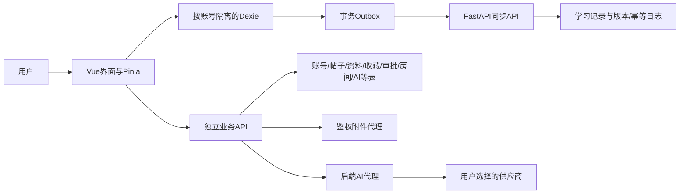

# 系统架构与权限边界

当前产品规则见[统一规则](PRD-当前规则.md)，本页区分实际结构与目标约束；不以开发批次划分能力。

## 1. 数据流

学习记录采用通用表；帖子、收藏、申请、消息和AI会话等保留独立业务表。不能因原图表画了一张逻辑实体就增加重复事实表，也不能把所有业务都强塞入学习记录。

## 2. 前端与离线

Vue 3/Vite/Pinia，Dexie分账号存学习数据、队列和镜像。本地写和入队在同一事务，在线/前台/手动触发同步；换号等待在途写入，迟到响应不得跨账号落库。AI会话通过本人后端接口读取，不把Key或会话放入学习同步。

业务数据、配置、个人时间节点和纯本地显示偏好分别管理。隐私开关由在线账号接口权威修改，旧本地资料或备份不能覆盖。

## 3. 后端和数据库

FastAPI/SQLAlchemy/Alembic。当前运行与自动化主要使用SQLite；生产MySQL需要实际迁移和回归，不能仅凭ORM推断已验证。迁移保留既有数据，先备份再在隔离副本验证；不为迎合文档命名重建用户库。

代码含数据库支持的临时状态、验证码/限流、邮件任务和调度；生产多进程一致性、任务租约和外部服务必须按实际配置验证，不以开发内存行为冒充生产证明。

## 4. 计时与统计

倒计时到计划边界结束本轮并提醒，正计时以180分钟保护；单次暂停30分钟保护。页面恢复和后端规范化使用同一口径。归属与统计采用明确的日期时区。学习事实与在线心跳独立，页面离线不会篡改已经结算的学习记录。

## 5. 小组与房间

受邀小组成员关系是学习共享边界；房间成员关系是房间准入边界，两者不可混用。隐私过滤在后端执行，影响学习记录、图片、排行、状态和位置。管理员无默认隐私旁路。

device_presence按设备记录网站在线、学习状态和当前房间，30秒心跳、90秒有效期；room_presences仅投影有效房间。多设备聚合活动会话，一台离场不覆盖另一台活动状态；私密房间位置仍须准入权限。

## 6. 附件

上传经后端校验真实图片类型、大小、随机key与配额；七牛AK/SK只在后端。读取先查归属、引用、受邀关系、隐私及审核状态。错题/AI私图鉴权代理并no-store可保留；签名URL只是一种传输凭据，不能替代权限。

公开内容审核与私人学习图片分别处理。用户知道key、登录、是平台管理员或加入公开房间，都不是读取他人私密附件的充分条件。

## 7. AI

受控OpenAI兼容地址，后端BYOK加密/解密和代理；模型目录按本人/服务商/地址/Key指纹隔离。目录只说明供应商声明的模型可见性，实际调用资格以供应商响应为准。已支持强制刷新、进程内同Key并发合并与安全错误分类；生产多进程需独立实测。

每次自动构建本人有界摘要，历史按配置截断。模型输出是不可信文本，不给DOM、系统文件或通用工具权限。只有校验成功的建议、本人预览和明确确认才允许导入普通任务；安全撤销还要比较记录版本和完成状态。

## 8. 管理与内容

账号封禁保留数据；VIP、授权、公告和审核留痕。资料与励志先审后公开，动态评论直接发布可管理删除。管理员不能修改他人学习记录或查看其AI会话/Key。配置和审核需防并发覆盖；公开内容编辑不能绕过原审核。

## 9. 部署、配置和完成证据

邮箱、OAuth、短信、七牛、AI和HTTPS配置在服务端环境中，不把值写进源码或前端。未配置明确显示条件并保持关闭；功能类型开关不能冒充媒体推流。

备份校验、恢复到新目录、诊断与真实供应商验收分别记录。单元/接口测试、实际数据库/对象存储、手机/多设备和生产验证是不同证据，状态统一见[开发状态](../implementation-status.md)。
