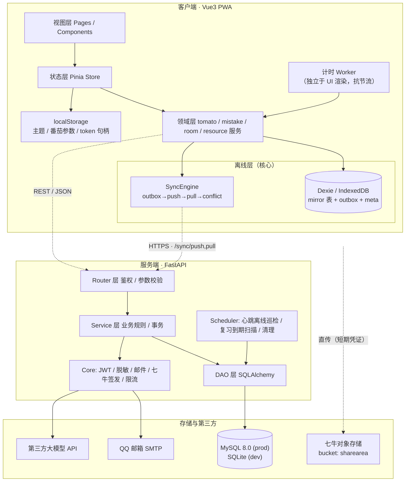
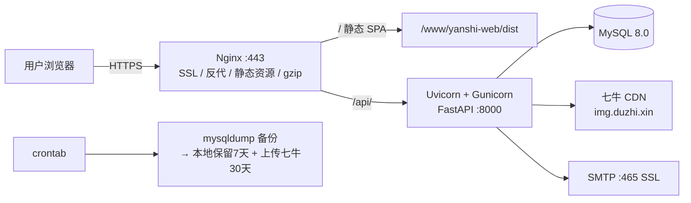

# 02 · 系统架构设计

| 版本 | v0.1.0 | 负责人 | solo |
|---|---|---|---|

---

## 1. 总体架构图



**分层铁律**：
1. UI 组件**禁止**直接调用 HTTP，必须经 `domain` 层（domain 内部决定读本地还是远端）
2. 读路径一律 `Dexie 优先`，网络只是本地数据的补充；写路径一律 `本地写 + outbox`
3. Service 层不得直接写 SQL；DB session 只在 DAO 层开关
4. 任何返回给其他用户的数据，必须过 `_serialize_member()` / `_serialize_resource()` 统一脱敏出口

---

## 2. 部署架构



| 环境 | 用途 | 数据库 | 域名 | Redis |
|---|---|---|---|---|
| `local` | 本地开发 | SQLite | localhost | 无 |
| `prod` | 线上唯一环境 | MySQL 8.0 | duzhi.xin | 无（一期） |

> 一期**不设预发布环境**（成本考量），用 `main` 分支 CI 冒烟 + 灰度式手动验证替代。上线前必须本地用 MySQL 跑一遍全量回归。

---

## 3. 技术选型决策记录（ADR）

### ADR-001 前端框架：Vue 3 + Vite + Pinia ✅
- **备选**：React 18 / Next.js
- **选择理由**：响应式心智负担低、单文件组件开发快、生态成熟；Vite 冷启动与 HMR 快
- **放弃 Next.js 的理由**：SSR 对「离线优先」无增益，反而增加 Node 常驻进程与部署复杂度
- **代价**：SEO 不支持（一期内容都在登录后，SEO 无价值）

### ADR-002 本地存储：Dexie（IndexedDB） ✅
- **备选**：localStorage / IndexedDB 裸 API
- **选择理由**：需要结构化查询（按日期查番茄、按 pending 查 outbox）、批量事务、容量足够 MB 级；localStorage 仅 5MB 且只有字符串
- **约定**：所有 mirror 表主键用**客户端生成的 UUID**（而非服务端自增 id），避免离线创建时 id 冲突

### ADR-003 后端框架：FastAPI + SQLAlchemy 2.0 + Alembic ✅
- **备选**：Django / Flask
- **选择理由**：异步支持、自动生成 OpenAPI、pydantic 校验省事、代码量小
- **代价**：生态不如 Django 全，后台管理需自己写（一期后台页面自研，成本可接受）

### ADR-004 数据库：SQLite(dev) → MySQL 8.0(prod) ✅
- **理由**：本地零配置；`SQLAlchemy` 屏蔽方言差异
- **强制约束**：
  - 所有字符串字段**显式声明长度**（`String(64)`），不得裸写 `String`（MySQL 下默认为 TEXT 且不能建索引）
  - 不使用 MySQL 不支持的特性；JSON 字段统一用 `JSON` 类型，SQLite 下走退化实现
  - 上线前必须在 MySQL 上跑一次完整回归（见 `10-OPS`）

### ADR-005 同步模型：Outbox + Revision 乐观锁（非 CRDT） ✅
- **备选**：CRDT / 最后写入胜利 LWW
- **理由**：同步对象以「个人私有数据」为主（番茄、错题、收藏），**同一账号多端冲突概率极低**；CRDT 实现成本高一个数量级
- **代价**：真冲突时需用户二选一（已确认可接受）
- **二期回头**：若出现协作编辑场景（多人共编错题本），再评估 CRDT

### ADR-006 一期不引入 Redis ✅
- **理由**：单机部署，日活目标 100；引入 Redis 增加运维与故障面
- **替代方案**：
  - 验证码限流 → **DB 计数 + 内存 LRU 窗口**（单机够用）
  - 心跳在线状态 → `room_member.last_heartbeat_at` + 30s 定时巡检任务
  - JWT 黑名单 → 一期不需要（退出登录即前端清 token；refresh_token 有 7 天有效期）

### ADR-007 站内消息：60s 轮询而非 WebSocket ✅
- **理由**：消息实时性要求低（审批类小时级可接受）；轮询实现简单，Nginx 无需额外 ws 配置
- **一期接口**：`GET /message/unread-count`（极轻量），完整列表按需拉取
- **二期**：切 SSE（FastAPI 原生支持，改造量小）

### ADR-008 图片上传：后端签发凭证 + 前端直传七牛 ✅
- **理由**：AK/SK 永不落前端；不占用服务器带宽
- **安全**：凭证有效期 10 分钟，限定 mime 类型与文件大小；上传后回调 `/upload/callback` 落库并校验

### ADR-009 AI 密钥：用户自填（方案 B），仅 VIP 可用 ✅
- **备选**：后端统一内置 Key（方案 A）
- **选择理由**：用户自担成本与额度，站长零成本、**零滥用风险**、无合规负担；同时天然成为 VIP 的一个卖点
- **代价**：需要自己做加密存储与限流（见下）
- **安全设计（强制）**：
  1. **加密存储**：AES-256-GCM，密钥来自 `AI_KEY_ENC_SECRET`；每条 Key 独立随机 nonce，密文 + nonce + tag 一起落库 → **脱库也拿不到明文**
  2. **永不回显**：接口只返回 `masked`（`sk-...abcd`）、`created_at`、`last_used_at`；修改必须重输完整 Key
  3. **传输**：HTTPS；前端不写 `localStorage` / Dexie，提交后内存即弃
  4. **调用**：后端解密 → 服务端发请求 → 只把模型回复回传；第三方错误**脱敏后**返回（不带 Key 片段）
  5. **限流**：单用户 10 次/分钟、200 次/天；超限返回 `429 AI_RATE_LIMIT`
  6. **隔离**：AI Key **不进离线同步**（敏感凭证，服务端单一权威）
  7. **轮换**：`AI_KEY_ENC_SECRET` 变更时需提供一次性的重加密迁移脚本

### ADR-011 AI 接入：统一 OpenAI 兼容适配器 + 实时拉取模型列表 ✅
- **背景**：用户自填 Key，若每家厂商各写一套 SDK，加一家就要改一次代码；且模型名迭代极快（半年一代），硬编码必然过期
- **决策**：
  1. **只实现一个 OpenAI 兼容适配器**（`/v1/chat/completions`），覆盖 DeepSeek / Kimi / GLM / 通义 / 硅基流动 / OpenAI / 中转站 / 本地 Ollama
  2. **模型名不硬编码**：保存 Key 后调用 `GET {base_url}/models`（带用户 Key）拉实时列表 → 前端下拉选择；失败则降级为「手动填写模型名」
  3. **预设 5 家服务商 + 自定义端点**，存在代码常量 `AI_PROVIDERS`（不用建表，二期再考虑后台可配）
  4. **流式输出**：用 `StreamingResponse` 逐 token 返回（AI 首字通常 5–20s，非流式体验不可接受）
  5. 一期**只做纯文本对话**：不支持图片/文件多模态输入、不支持 function calling、不支持联网搜索
- **代价**：非标准协议的服务商接不进来（一期可接受，需要时再写第二个适配器）

### ADR-012 AI 能力分阶段演进（P0 一期 / P1 中期 / P2 后期）✅

> 原则：**一期只做"打字问答"，把复杂能力全部推到中后期**，避免 AI 模块吃掉整个项目工期。

#### P0 · 一期（Must）
| 能力 | 实现 |
|---|---|
| 协议 | 单一 OpenAI 兼容适配器 |
| 输出 | 流式（StreamingResponse），超时 60s |
| 输入 | **纯文本**（不支持图片/文件） |
| 上下文 | **最近 N 条历史，按条数截断**（默认 `N=10`，可配 5/10/20） |
| Token 统计 | 记录第三方返回的 `usage`；服务商不返回时记 0，**不做本地精确计算** |
| 用量展示 | 单条对话显示本次 token 与耗时；不做聚合面板 |
| 限流 | 10 次/分、200 次/天 |
| 不做 | 多模态 / function calling / 联网搜索 / Agent |

#### P1 · 中期（二期）
| 能力 | 实现要点 | 备注 |
|---|---|---|
| **图片输入（多模态）** | 错题拍照 → 直接问 AI（与错题本联动，**价值最高、优先做**） | 各家图片格式不同：`image_url` base64 / `image` 数组 → 需引入 provider 适配层 |
| **上下文按 token 精确截断** | 滑动窗口 + 超出部分做摘要压缩；用 `tiktoken` 近似估算（国内模型 tokenizer 不开放，用 `chars×1.5` 粗估 + 第三方 usage 校准） | 解决"聊着聊着忘了前面" |
| **用量面板** | 按日/月聚合 token 与估算费用（维护 provider 单价表） | 用户花自己的钱，需要看得见 |
| **会话管理** | session 列表 / 重命名 / 删除 / 导出 Markdown | — |
| **系统人设自定义** | 用户可填 system prompt（如"你是考研数学老师"） | — |
| **高级参数** | temperature / top_p / max_tokens 可调 | 默认 0.7 |
| **容错** | 失败重试 1 次；主 Key 不可用时自动切备用 Key | 需要允许多 Key 配置 |

#### P2 · 后期（三期及以后）
| 能力 | 说明 |
|---|---|
| **function calling / 工具调用** | "把这道题加入我的错题本"、"帮我排一个复习计划" —— 需要定义工具集与权限确认流程 |
| **联网搜索** | 依赖第三方搜索 API，成本与稳定性待评估 |
| **Agent** | 多步解题、自动组卷、错题归因分析，复杂度最高 |
| **AI 生成相似题 / 自动批改** | 与错题本深度耦合，需先有 P1 的多模态 |
| **本地模型优化** | Ollama / vLLM 直连的体验优化（无网络依赖、零成本） |

#### 架构影响（提前预留，避免中期重构）
1. **provider 适配层**：P0 只有 1 个适配器；P1 上多模态时，把 `AIProvider` 抽象成基类（文本 / 多模态 / 工具调用三个能力开关），各家实现差异只落在子类里 —— **现在就把接口留出来，别写成一坨 if-else**
2. **上下文策略可插拔**：`ContextStrategy` 接口（`by_count` / `by_token` / `by_summary`），P0 只实现 `by_count`
3. **用量埋点**：`ai_chat` 现在就把 `prompt_tokens / completion_tokens / latency_ms` 记下来，P1 做面板时**不用补历史数据**
4. **Key 多实例预留**：`user_ai_key` 当前 `user_id` 唯一；P1 支持备用 Key 时改为 `(user_id, provider)` 唯一并加 `is_primary` —— **一期建表时直接按此设计，省一次 migration**

### ADR-013 AI 模型库自动更新（防模型名过时）✅
模型名迭代极快，任何硬编码都会过期。三层兜底，缺一不可：

| 层 | 机制 | 准确性 | 失败时 |
|---|---|---|---|
| **① 实时拉取**（首选） | 用**用户自己的 Key** 调 `GET {base_url}/models` | 最高（就是该账号能用的） | 降级到 ② |
| **② 内置目录定时同步** | 每周定时任务，从各厂商公开模型清单 / 公开模型索引站同步 → `ai_model_catalog` 表 | 中 | 保留上次同步结果 |
| **③ 手动填写**（兜底） | 用户直接输入 model_id | 取决于用户 | 永远可用 |

- 拉取结果缓存 24h（`user_ai_key.models_cache`），前端下拉展示：**推荐标记 / 是否支持图片 / 上下文长度**
- 三层都失败也不阻断使用：允许手填，并在 UI 提示"未能获取模型列表，请手动填写"
- 新增模型（如厂商发布新版）无需发版 —— ① 当天生效，② 一周内补齐推荐位

### ADR-014 Feature Flag：代码写完但功能关闭 ✅
**背景**：视频小房间/云端自习室、微信/手机号/QQ 登录要求「程序写完、暂不开放」。

- **开关权威在后端**：`GET /config` 返回 `{ features: [...], auth_channels: [...] }`，前端**只按后端下发渲染入口**
- **禁止**前端用常量判断功能是否开放（否则开关形同虚设，改一次要发版）
- 后端同时兜底：关闭的功能其 API 直接返回 `403 FEATURE_DISABLED`，不依赖前端自觉
- 开关来源：`.env` 的 `FEATURES`（逗号分隔）
  - 一期默认：`FEATURES=checkin_room,resource,post,inspiration,dream_school`
  - 关闭项：`video_small_room`、`cloud_video_room`、`auth_wechat`、`auth_phone`、`auth_qq`
- 关闭的功能**代码、表结构、迁移全部保留**，打开开关即可上线，不需要重新开发

### ADR-015 虚拟形象：预设静态库，不做装扮系统 ✅
- 一期提供 **8–12 款预设形象**（内置 SVG 或七牛图片），用户在个人中心单选，存 `user.figure_id`
- 展示：成员列表 = 形象图 + 状态角标（专注/休息/空闲/离线）+ 昵称
- **一期不做**：换装、部件组合、形象编辑器（复杂度与收益不匹配）
- 加载失败降级为默认灰色形象，不显示破图

### ADR-010 权限字段服务端权威，客户端不可写 ✅
- **背景**：`user` 表走同步，如果允许客户端推送 `vip_level` / `role`，等于把提权漏洞写进了同步协议
- **决策**：同步字段**白名单制**
  - ✅ 客户端可写：`nickname`、`avatar_url`、`signature`、`privacy_mode`、`tomato_setting` 参数
  - ❌ 服务端权威（只下发，客户端推送一律丢弃并记 WARN）：`vip_level`、`vip_expire_at`、`role`、`status`
- **落地**：`POST /sync/push` 对 `profile` 表做字段过滤，非白名单字段直接剔除；出现异常多次记录安全日志
- **代价**：无实测成本，属于必须做的防护

---

## 4. 环境配置与密钥管理

```bash
yanshi-server/.env.example      # 提交到 git（全占位值）
yanshi-server/.env.dev          # 本地，gitignore
yanshi-server/.env.prod         # 服务器，gitignore
```

| 变量 | 用途 | 缺失时降级行为 |
|---|---|---|
| `APP_ENV` | local / prod | — |
| `DB_URL` | 数据库连接 | 默认本地 sqlite |
| `JWT_SECRET` / `JWT_REFRESH_SECRET` | 令牌签发 | 本地自动随机生成 |
| `QQ_SMTP_HOST/USER/AUTH_CODE` | 邮件 | `SMTP_ENABLED=false` → 验证码打印到日志 |
| `QINIU_AK/SK/BUCKET/CDN_HOST` | 对象存储 | `OSS_ENABLED=false` → 本地 `static/upload/` 临时目录 + 默认头像 |
| `AI_KEY_ENC_SECRET` | **加密用户 AI Key 的主密钥**（32 字节） | 无 → AI 功能禁用（**绝不能留空上线**） |
| `AI_PROVIDERS_DEFAULT` | 新用户默认服务商（deepseek） | 默认 deepseek；**不配置任何厂商 Key** —— 一期为用户自填（ADR-009） |
| `BOOTSTRAP_ADMIN_EMAIL` | 首个管理员 | 必填（启动时自动赋权） |
| `MAX_TOMATO_MINUTES` | 番茄上限 | 默认 180 |
| `TZ` | 时区 | 强制 UTC，禁止改动 |

> 铁律：代码里**零硬编码**密钥；CI 加一步密钥扫描（`gitleaks`）兜底。

---

## 5. 安全设计

| 风险 | 对策 |
|---|---|
| **JWT 被盗（XSS）** | access_token 存**内存**（Pinia），refresh_token 存 **httpOnly + Secure + SameSite=Lax** Cookie；不用 localStorage 存 token |
| **XSS（帖子/评论渲染）** | 一律**纯文本渲染**（换行转 `<br>` 由 Vue 文本插值完成），或经白名单 Markdown 解析器；**禁止 `v-html` 渲染用户输入** |
| **CSRF** | 同源部署 + SameSite=Lax；写操作要求自定义头 `X-Client: web`，配合 access_token 校验 |
| **SQL 注入** | 全 ORM 参数化；禁用字符串拼接 SQL |
| **上传木马（HTML/SVG）** | 后端**不中转文件内容**，仅签发凭证；上传后回调时按 magic bytes 校验真实类型 → jpg/png/webp；文件名强制 `{uuid}.{ext}`，CDN 侧统一 `Content-Type` 且禁用 HTML 渲染 |
| **越权（水平越权）** | 所有资源操作 DAO 层强制带 `user_id` 过滤；删除/编辑接口先查权限再执行 |
| **越权（垂直）** | 管理员接口统一依赖 `Depends(require_admin)` 装饰器 |
| **刷验证码** | IP + 邮箱双维度限流（见 UC-01） |
| **暴力破解** | 验证码错误 5 次作废；同一 IP 连续失败 20 次封 30 分钟 |
| **用户 AI Key 泄露** | 加密存储 + 只回显掩码 + 服务端代调 + 限流（见 ADR-009） |
| **客户端伪造 VIP** | 同步字段白名单，`vip_level`/`role` 服务端权威（见 ADR-010） |
| **管理员误操作/滥用** | 所有 VIP 变更写 `admin_operation_log`（操作人/前后值/备注），日志只增不改 |
| **内容合规** | 发帖页免责声明 + 后台人工审核 + 违规软删 |
| **依赖漏洞** | 每月 `pip-audit` / `npm audit`； Dependabot 开启 |

---

## 6. 日志与可观测

- 格式：**结构化 JSON**（`time, level, trace_id, user_id, path, msg`）
- `trace_id` 由中间件生成，响应头回传 `X-Trace-Id`；前端报错上报时携带
- 分级使用规范：
  - `INFO`：登录、审批、同步成功
  - `WARN`：限流触发、验证码错误、余票不足类的业务异常
  - `ERROR`：未捕获异常、第三方调用失败（含邮件失败、七牛失败）
- 禁止：生产打印 DEBUG、打印完整 JWT、打印用户邮箱明文（脱敏为 `12***@qq.com`）
- 一期不接 APM / Sentry（成本），用 `docker`-less 的 `journalctl` + 日志轮转 + 每日异常汇总邮件替代

---

## 7. 目录结构

```
yan-shi/
├─ yanshi-web/                    # Vue3 前端
│  ├─ src/
│  │  ├─ api/                     # HTTP 请求封装（仅 domain 层调用）
│  │  ├─ domain/                  # 领域服务：tomato / mistake / room / resource / sync
│  │  ├─ stores/                  # Pinia：user / timer / room / ui
│  │  ├─ db/                      # Dexie schema + mirror DAO
│  │  ├─ pages/  components/  router/  assets/
│  │  ├─ styles/                  # tokens.css（唯一色值/时长来源）
│  │  └─ utils/                   # clock / format / crypto
│  └─ public/
├─ yanshi-server/                 # FastAPI 后端
│  ├─ app/
│  │  ├─ main.py
│  │  ├─ api/v1/                  # routers
│  │  ├─ services/                # 业务逻辑/事务
│  │  ├─ dao/                     # 数据访问
│  │  ├─ models/                  # ORM 实体
│  │  ├─ schemas/                 # pydantic 出入参
│  │  ├─ core/                    # config / security / deps / response / errors
│  │  ├─ jobs/                    # 定时任务
│  │  └─ alembic/versions/
│  └─ data/                       # sqlite 存放（gitignore）
├─ docs/
└─ README.md / LICENSE / .gitignore
```

---

## 8. 性能预算（一期）

| 指标 | 目标值 |
|---|---|
| 前端打包体积（gzip 后首屏 JS） | ≤ 300KB |
| 图片 | 一律走七牛 + WebP；列表缩略图 ≤ 100KB |
| 单 API P95 | 读 ≤ 150ms，写 ≤ 300ms |
| 同步单批大小 | 50 条 / 批，避免大包超时 |
| SQLite→MySQL 差异回归 | 上线前 1 次全流程 |
