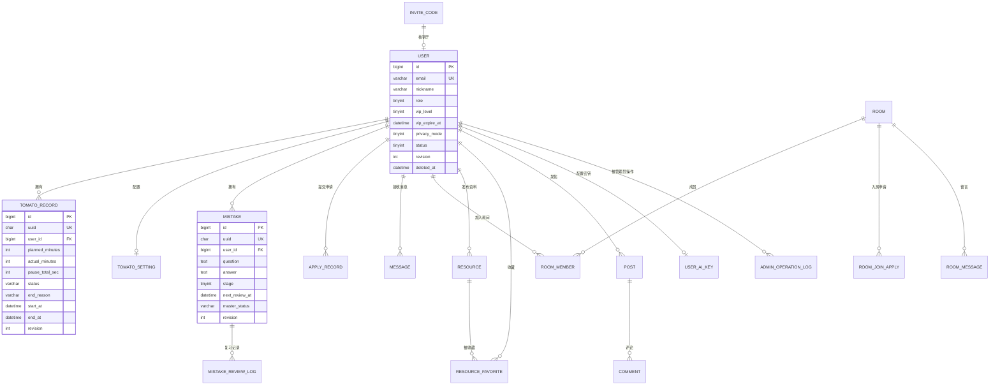

# 03 · 数据库设计

| 引擎 | MySQL 8.0（生产） / SQLite（开发） | 字符集 | utf8mb4_general_ci |
|---|---|---|---|

---

## 1. ER 图（核心）



---

## 2. 通用约定（所有表必须遵守）

| 约定 | 说明 |
|---|---|
| **主键** | `id BIGINT AUTO_INCREMENT`（服务端内部主键） |
| **业务主键** | `uuid CHAR(36)` —— **客户端生成**，同步与幂等的锚点，唯一索引 |
| **软删** | `deleted_at DATETIME NULL`，不用物理删除；所有查询默认过滤 `deleted_at IS NULL` |
| **同步字段** | `revision INT DEFAULT 1`（每次更新 +1）、`updated_at DATETIME(6)`（微秒，用作 pull cursor）、`sync_deleted TINYINT`（删除墓碑，随同步传播） |
| **两个删除字段的分工** | `deleted_at` = 业务时间戳（谁在何时删的，后台审计用）；`sync_deleted` = 同步墓碑（0/1，pull 时判断是否让客户端删本地）。**删除时必须同时写**：`deleted_at=now(), sync_deleted=1`。业务查询用 `deleted_at IS NULL`，同步拉取用 `sync_deleted` |
| **时间** | 全部 **UTC** 存储，`DATETIME(6)`；前端渲染前转本地时区 |
| **命名** | 表名复数或单数统一：**一律单数**；字段小写下划线 |
| **金额/计数** | 时长统一存**秒**或**分钟**（字段名显式带 `_sec` / `_minutes`），禁止裸数字 |
| **JSON** | 用 `JSON` 类型（MySQL）；SQLite 下 SQLAlchemy 退化 TEXT |

**pull cursor 约定**：`cursor = base64("<updated_at_微秒>|<id>")`，按 `(updated_at, id)` 升序取变更，避免同毫秒分不清先后。

---

## 3. 表清单（29 张）

### 3.1 账号与权限

**`user`** — 用户主表
| 字段 | 类型 | 说明 |
|---|---|---|
| id / uuid | bigint / char36 | — |
| email | varchar(64) UK | QQ 邮箱，唯一 |
| nickname | varchar(32) | 默认 `研友xxxx` |
| avatar_url | varchar(255) | 七牛 URL |
| figure_id | varchar(32) | **虚拟形象 ID**（自习室展示用，预设库中选；为空降级默认形象） |
| signature | varchar(120) | 个性签名（原 `bio`） |
| role | tinyint | 0 普通 / 1 管理员 |
| vip_level | tinyint | 0 普通 / 1 VIP |
| vip_expire_at | datetime NULL | VIP 到期时间，**NULL = 永久**；管理员后台可调 |
| vip_updated_at | datetime | 最近一次 VIP 变更时间 |
| privacy_mode | tinyint | 0 关 / 1 开（**服务端持久化**） |
| status | tinyint | 1 正常 / 2 封禁 |
| revision / updated_at / deleted_at | — | 同步三件套 |
| created_at | datetime | — |

> **索引**：`uk_email(email)`、`uk_uuid(uuid)`、`idx_vip(vip_level)`
> **番茄参数不在此表**：唯一权威是 `tomato_setting`（见 3.2）。离线镜像经 pull 展平为 `profile.setting_*` 键下发，**不做双份存储**（避免又一次 `signature`/`bio` 式的字段二义）。

**`user_ai_key`** — 用户自建 AI 密钥（仅 VIP 可配置，1:1）
| 字段 | 类型 | 说明 |
|---|---|---|
| id | bigint | — |
| user_id | bigint | — |
| provider | varchar(24) | 服务商（deepseek / moonshot / zhipu / siliconflow / openai / custom） |
| is_primary | tinyint | 主 Key=1；**P1 支持备用 Key 后启用**，一期恒为 1（建表即预留，省一次 migration） |
| api_base | varchar(255) | 用户可自定义端点（可空用默认） |
| key_cipher | varbinary(512) | **AES-256-GCM 密文**（含 nonce+tag，永不回传前端） |
| key_mask | varchar(32) | 展示用掩码 `sk-...abcd` |
| model | varchar(64) | 当前使用的模型名（**由用户在实时列表中选，或手填**） |
| models_cache | json | 上次拉取到的可用模型列表（缓存，24h） |
| models_synced_at | datetime | 上次拉取模型列表时间 |
| status | tinyint | 1 启用 / 0 停用（非 VIP 时自动停用，不删除） |
| last_used_at | datetime | — |
| created_at / updated_at | datetime | — |

> **索引**：`uk_user_provider(user_id, provider)` ← 按 `02-ARCH` ADR-012 预留，中期支持多 Key 时不用改表
> **铁律**：本表**不进离线同步**；任何接口不得返回 `key_cipher`；DB 备份文件同等视为敏感数据。

**`admin_operation_log`** — 管理员操作留痕（只增不改不删）
| 字段 | 类型 | 说明 |
|---|---|---|
| id | bigint | — |
| admin_id | bigint | 操作人 |
| target_type | varchar(24) | user / post / resource / apply |
| target_id | bigint | 对象 ID |
| action | varchar(32) | vip_grant / vip_renew / vip_revoke / content_delete / apply_approve ... |
| before_value | json | 变更前快照 |
| after_value | json | 变更后快照 |
| remark | varchar(200) | 必填（≥5 字） |
| ip | varchar(45) | — |
| created_at | datetime | — |

> **索引**：`idx_target(target_type, target_id)`、`idx_admin_time(admin_id, created_at)`
> **约束**：不提供删除/修改接口；保留 ≥180 天

**`email_code`** — 验证码（MySQL：`email_code`）
| 字段 | 类型 | 说明 |
|---|---|---|
| id | bigint | — |
| email | varchar(64) | — |
| code_hash | char(64) | SHA256(**不存明文**) |
| scene | varchar(16) | register / login / reset |
| expires_at | datetime | 签发 +5min |
| used | tinyint | 是否已核销 |
| ip | varchar(45) | 限流用 |
| fail_count | tinyint | 错 5 次作废 |
| created_at | datetime | — |

> **索引**：`idx_email_scene(email, scene, created_at)`、`idx_expires(expires_at)`（定时清理 T+1 天）

**`email_log`** — 邮件发送流水（双通道通知的失败兜底）
| 字段 | 类型 | 说明 |
|---|---|---|
| id | bigint | — |
| user_id | bigint NULL | 系统邮件可为空 |
| to_email | varchar(64) | 收件人（日志脱敏展示） |
| scene | varchar(16) | code / apply_result / vip_change |
| subject | varchar(120) | — |
| status | varchar(12) | pending / sent / fail |
| retry | tinyint | 已重试次数（上限 3） |
| last_error | varchar(200) | 失败原因（脱敏，不含授权码） |
| biz_type / biz_id | varchar(24) / bigint | 关联业务，便于后台按申请/用户回溯 |
| created_at / sent_at | datetime | — |

> **索引**：`idx_status_created(status, created_at)`（后台失败队列）、`idx_biz(biz_type, biz_id)`
> **铁律**：邮件失败**不影响主流程**（站内消息已在同一事务落库）；后台可按 `status=fail` 手动重发，重发复用同一行并 `retry+1`。
> **与 `message` 的分工**：`message` 是用户可见的站内消息（业务真相），`email_log` 只是投递流水（可丢、可重试），二者不互为前置。

**`invite_code`** — 邀请码
| 字段 | 类型 | 说明 |
|---|---|---|
| id / code | bigint / varchar(32) UK | — |
| batch_no | varchar(32) | 生成批次，便于后台管理 |
| status | tinyint | 0 未用 / 1 已用 / 2 作废 |
| used_by | bigint | 使用人 |
| used_at | datetime | — |
| created_at | datetime | — |

**`apply_record`** — 功能使用申请
| 字段 | 类型 | 说明 |
|---|---|---|
| id / uuid | bigint / char36 | — |
| user_id | bigint | 申请人 |
| item_key | varchar(32) | 申请项key（如 `resource_full_link`） |
| reason | varchar(500) | 申请理由 |
| status | varchar(16) | pending / approved / rejected / revoked |
| reject_reason | varchar(200) | 驳回必填 |
| auditor_id / audited_at | bigint / datetime | 审批人/时间 |
| revision / updated_at / sync_deleted | — | 同步三件套 |
| created_at | datetime | — |

> **索引**：`idx_user_status(user_id, status)`、`idx_status_created(status, created_at)`（后台列表）
> **并发**：审批用 `UPDATE ... WHERE id=? AND status='pending'` 乐观锁，影响行数 0 → 返回"已被处理"

**`user_feature_grant`** — 功能使用权授予（**审批的落地结果**）
| 字段 | 类型 | 说明 |
|---|---|---|
| id | bigint | — |
| user_id | bigint | 被授予人 |
| item_key | varchar(32) | 申请项 key，取值见下方字典 |
| source_apply_id | bigint NULL | 来自哪次审批（管理员手工授予时为空） |
| granted_at | datetime | 授予时间 |
| expire_at | datetime NULL | **NULL = 长期有效** |
| revoked_at | datetime NULL | 撤销时间（软撤销，不删行） |
| auditor_id | bigint | 授予人 |

> **唯一索引**：`uk_user_item(user_id, item_key)`
> **一期 `item_key` 字典**（代码常量 `FEATURE_ITEMS`，与前端下拉同源）：`resource_full_link` / `room_unlimited` / `ai_access`
> **铁律**：**鉴权只读本表，不读 `apply_record.status`** —— 申请是流程，授权是事实，两者分离才能支持「管理员手工授予」与「到期/撤销」。
> **审批落地**：通过 = **同一事务**内 写 `user_feature_grant`（upsert）+ 写 `message` + 写 `admin_operation_log`；邮件异步。
> **与 VIP 的关系**：`vip_level=1` 视为拥有全部 item_key，鉴权表达式 = `is_vip() or grant_exists(item_key)`。

**`message`** — 站内消息
| 字段 | 类型 | 说明 |
|---|---|---|
| id / user_id | bigint | — |
| type | varchar(24) | apply_result / system / conflict / content_deleted / **vip_change** |
| title / content | varchar(120) / varchar(1000) | — |
| biz_type / biz_id | varchar(24) / bigint | 关联业务（用于幂等与跳转） |
| is_read | tinyint | 0 未读 |
| created_at | datetime | — |

> **唯一索引**：`uk_dedup(user_id, biz_type, biz_id)` ← **防止重复通知**（关键）
> **索引**：`idx_user_read(user_id, is_read, created_at)`

### 3.2 番茄钟

**`tomato_setting`** — 用户番茄参数（1:1，**唯一权威**）
`user_id`(UK) / `focus_min`(25) / `short_break_min`(5) / `long_break_min`(15) / `long_break_interval`(4, 范围1–8) / `auto_next`(0 固定0) / `revision` / `updated_at`
> **同步口径**：本表不出现在 pull 的 `tables` 参数里，而是由服务端**展平为 `profile.setting_*` 键**随 `profile` 下行（`setting_focus_min` 等），客户端写回时反向映射。原因：Dexie 的 `profile` 是 key-value 表，新增一个实体表要改 schema 版本，展平可以零成本扩参数。详见 `04-SYNC` §5.1。

**`tomato_record`** — 番茄记录
| 字段 | 类型 | 说明 |
|---|---|---|
| id / uuid | bigint / char36 UK | uuid 客户端生成 |
| user_id | bigint | — |
| mode | varchar(16) | **countdown 倒计时 / countup 正向计时**（正向计时 planned=0） |
| content | varchar(64) | **学习内容**（如"数学-线代"），扇形统计的分组维度 |
| planned_minutes | int | 计划时长 |
| actual_minutes | int | **有效时长 = min(流逝-暂停, 180)** |
| pause_total_sec | int | 累计暂停秒数 |
| status | varchar(16) | done / quit |
| end_reason | varchar(24) | manual_done / manual_quit / timeout / pause_timeout |
| start_at / end_at | datetime | **UTC，服务端校正时间戳** |
| clock_offset_ms | int | 客户端时钟偏差，备查 |
| revision / updated_at / sync_deleted | — | 同步三件套 |
| created_at | datetime | — |

> **索引**：`idx_user_start(user_id, start_at)`（统计/列表）、`idx_cursor(updated_at, id)`（pull）
> **约束**：`actual_minutes BETWEEN 0 AND 180`（应用层 + CHECK）

### 3.3 错题本

**`mistake`**
| 字段 | 类型 | 说明 |
|---|---|---|
| id / uuid / user_id | — | — |
| title | varchar(200) | 题目摘要 |
| question / answer | text | 题面 / 解析 |
| idea | text | **主要思路** |
| question_img | varchar(255) | **拍照录入：题目图**（七牛） |
| answer_img | varchar(255) | **拍照录入：解析图**（七牛） |
| error_type | varchar(32) | **错误类型**（可用户自定义，见 `user_error_type`） |
| tags | json | `["数学","线代"]` |
| stage | tinyint | 0–7，对应 8 个复习节点 |
| next_review_at | datetime | 下次复习时间（UTC） |
| master_status | varchar(16) | pending / mastered / restrengthen |
| reviewed_count | int | 复习次数 |
| revision / updated_at / sync_deleted | — | — |
| created_at | datetime | — |

> **索引**：`idx_user_next(user_id, next_review_at)` ← 「今日待复习」核心查询
> **索引**：`idx_user_status(user_id, master_status)`

**`mistake_review_log`**
`id` / `mistake_uuid` / `user_id` / `stage`(复习时处于第几节点) / `action`(mastered|restrengthen) / `reviewed_at`
> **索引**：`idx_user_time(user_id, reviewed_at)`

### 3.4 自习室

**`room`**
`id` / `uuid` / `type`(varchar: checkin|video_small|cloud_video) / `name` / `intro` / `cover_url` / `owner_id` / `visibility`(public|private) / `invite_code`(varchar 16 UK, **私密房间邀请码，可重新生成**) / `status`(active|dismissed) / `member_limit`(int) / `sort` / `created_at`
> **私密房间**：凭邀请码/邀请链接加入**免审核**；无码用户搜索不到，只能提交入房申请走房主审核
> **索引**：`idx_type_status(type, status, sort)`、`idx_owner(owner_id)`

**`room_member`**
`id` / `room_id` / `user_id` / `role`(owner|member) / `joined_at` / `last_heartbeat_at` / `online`(tinyint, 由巡检维护，**非实时**)
> **唯一索引**：`uk_room_user(room_id, user_id)`
> **索引**：`idx_heartbeat(room_id, last_heartbeat_at)` ← 在线列表查询

**`room_join_apply`**（私密房间）
`id` / `room_id` / `user_id` / `status`(pending|approved|rejected) / `message` / `created_at` / `handled_at` / `handled_by` / `pending_key`(生成列)
> **唯一索引**：`uk_pending(pending_key)`，其中 `pending_key = IF(status='pending', CONCAT(room_id,'-',user_id), NULL)` STORED
> **为什么不用 `uk(room_id, user_id, status)`**：那会把「同一房间同一人每种状态只能有一条」写死 —— 用户被驳回第二次时，`(room, user, 'rejected')` 已存在，插入直接报唯一键冲突，**第二次申请永远提交不了**。生成列只约束"待审唯一"，历史记录可以留多条。
> **索引**：`idx_status(room_id, status)` ← 房主待办列表

**`room_message`**（房间留言，仅在线）
`id` / `room_id` / `user_id` / `content`(varchar 500) / `created_at` / `deleted_at`
> **索引**：`idx_room_created(room_id, created_at)`

### 3.5 资料 / 社区 / 内容

**`resource`**
`id` / `user_id` / `title`(varchar 120) / `url`(varchar 500, **明文存**) / `extract_code`(varchar 16) / `category`(varchar 24) / `tags`(json) / `intro`(varchar 500) / `view_count` / `created_at` / `deleted_at`
> **索引**：`idx_created(created_at)`、`idx_user(user_id)`、`idx_category(category, created_at)`
> **安全**：完整 URL **只在 VIP / 作者 / 管理员的序列化出口返回**，普通用户序列化时脱敏

**`resource_like`** — 资料点赞（在线动作，走服务端计数）
`id` / `user_id` / `resource_id` / `created_at`
> **唯一索引**：`uk_user_res(user_id, resource_id)` ← 一人一次，可取消（删除即取消）

**`resource_favorite`**（走同步）
`id` / `uuid` / `user_id` / `resource_id` / `revision` / `updated_at` / `sync_deleted`
> **唯一索引**：`uk_user_res(user_id, resource_id)`

**`post`**（**纳入离线同步**，支持离线发帖）
`id` / `uuid`(char36 UK) / `user_id` / `title`(varchar 120) / `content`(text) / `images`(json) / `like_count` / `view_count` / `status`(normal|hidden) / `sync_status`(tinyint, **0 本地草稿 / 1 已上架**) / `revision` / `updated_at`(datetime6) / `sync_deleted` / `created_at` / `deleted_at`
> **索引**：`idx_status_created(status, created_at)`、`idx_user(user_id)`、`idx_cursor(updated_at, id)`
> **同步说明**：作者本人可改，冲突面窄；同步前仅本机可见（前端必须显示"待上传"角标，避免用户以为已发布）

**`comment`**（支持二级回复）
`id` / `post_id` / `user_id` / `parent_id`(bigint, **一级为 0**) / `reply_to_user_id`(bigint, 被回复人) / `level`(tinyint, **1 或 2，最多二级**) / `content`(varchar 500) / `created_at` / `deleted_at`
> **索引**：`idx_post(post_id, created_at)`、`idx_parent(parent_id)`
> **规则**：对二级评论的回复仍挂在其父评论下（`parent_id` = 一级评论 id，`reply_to_user_id` 指向被回复人），**不产生第三层**；删除父评论时子回复一并软删

**`inspiration`**（励志区「大雪深埋」· **UGC 投稿 + 审核**）
`id` / `user_id`(**投稿人，所有用户可投**) / `content`(varchar 300, 文案) / `image_url`(varchar 255, 配图) / `status`(varchar 16, **pending / approved / rejected**) / `reject_reason`(varchar 200) / `audited_at`(datetime) / `auditor_id`(bigint) / `sort`(int) / `created_at`
> **索引**：`idx_status_sort(status, sort)` ← 轮播池只查 `approved`
> **铁律**：`status != approved` 的内容**任何公开接口都不得返回**

**`dream_school`**（梦校墙 · **7 所**）
`id` / `name`(varchar 32) / `image_url`(varchar 255, 校园风景) / `intro`(varchar 200) / `sort`(int, 轮播顺序) / `enabled`(tinyint)
> **一期固定 7 所**：清华大学 / 北京大学 / 浙江大学 / 复旦大学 / 上海交通大学 / 南京大学 / 中国科学技术大学
> **展示**：轮播 + 动态特效（见 `07-UI`）；图片走七牛 CDN

**`ai_chat`**（对话历史）
`id` / `user_id` / `session_id`(char36) / `role`(user|assistant) / `content`(text) / `model`(varchar 64) / `prompt_tokens`(int) / `completion_tokens`(int) / `status`(ok|error, **error 只存脱敏提示**) / `latency_ms`(int) / `created_at`
> **索引**：`idx_session(session_id, created_at)`、`idx_user_time(user_id, created_at)` ← P1 用量面板聚合用

**`user_error_type`** — 用户自定义错误类型
`id` / `uuid` / `user_id` / `name`(varchar 32) / `sort`(int) / `is_preset`(tinyint, 系统预置) / `created_at` / `deleted_at`
> **预置 6 类**：概念不清 / 计算错误 / 审题失误 / 方法不会 / 记忆模糊 / 粗心
> **索引**：`idx_user(user_id, sort)`；用户可增删改自己的类型

**`user_auth`** — 第三方账号绑定（**微信/手机号/QQ 登录代码预留，一期关闭**）
`id` / `user_id` / `provider`(varchar 16: wechat|qq|phone) / `openid`(varchar 64) / `unionid`(varchar 64) / `phone`(varchar 20, 加密存储) / `bound_at`
> **唯一索引**：`uk_provider_openid(provider, openid)`
> **说明**：一期不开放登录入口，但表与 OAuth 抽象层先建好；`phone` 同样加密存储（合规要求）

**`ai_model_catalog`** — 主流模型库（**自动更新，防模型名过时**）
`id` / `provider`(varchar 24) / `model_id`(varchar 64) / `display_name`(varchar 64) / `context_window`(int) / `multimodal`(tinyint, 是否支持图片) / `is_recommended`(tinyint) / `source`(varchar 16, official|manual) / `synced_at`(datetime)
> **唯一索引**：`uk_provider_model(provider, model_id)`
> **更新机制**：见 `02-ARCH` ADR-013（三层兜底）
> **Token 口径（P0）**：取第三方返回的 `usage`；服务商不返回时置 0，**不做本地精确计算**（P1 再上 tiktoken 估算，见 `02-ARCH` ADR-012）
> **注意**：这几个字段一期就记，中期做用量面板时不用补历史数据

### 3.6 同步引擎

**`sync_op_log`** — 同步操作幂等日志（**"不多不少"的唯一保证**）
| 字段 | 类型 | 说明 |
|---|---|---|
| id | bigint | — |
| user_id | bigint | 防越权：查日志必须带 user_id |
| op_id | char(36) UK | **客户端生成的幂等键**，与 outbox 的一条 mutation 一一对应 |
| table_name | varchar(24) | tomato / mistake / favorite / post / apply / profile |
| uuid | char(36) | 目标记录业务主键 |
| op | varchar(12) | create / update / delete |
| status | varchar(12) | ok / conflict / error |
| rev | int NULL | 应用后的 revision（conflict 时为服务端当前 rev） |
| result | json | **原样回放的 per-op 结果**（重试时直接返回，不重新计算） |
| created_at | datetime(6) | — |

> **唯一索引**：`uk_op_id(op_id)` ← 幂等锚点，重复提交直接命中
> **索引**：`idx_user_created(user_id, created_at)`（7 天清理任务用）
> **写入时机**：`push` 应用成功**或**判定为 conflict 时都要写 —— 重放冲突也必须返回同一个冲突结果，否则客户端第二次重试会拿到不同答案。
> **与 `revision` 的关系**：`revision` 防"旧版本覆盖新版本"（并发正确性），`op_id` 防"同一次操作做两遍"（重试正确性）。两者缺一不可，别用一个替代另一个。
> **保留期**：7 天（`clean_sync_op_log` 任务），远大于客户端最大重试行窗口（5 次 × 指数退避）。

---

### 3.7 二期预留：圈子与共享（**不计入一期 29 张**）

> 这三张表服务于 `01-PRD` §8 的社区草案，**二期才建**，一期不要建、也不要提前加 `circle_id`。
> 一期建表只需不做与它们**冲突**的设计（别把"房间码"写死成唯一入口、别把 `room` 当成单例）；二期再加列回填，成本很低。
> 反过来，若一期就把 `room.circle_id` 加上，会留下大量 NULL 外键，还让一期的插入逻辑多一个必填项——**别提前留**。

**`circle`** — 圈子主体（长期关系）

| 字段 | 类型 | 说明 |
|---|---|---|
| id / uuid | bigint / char36 | — |
| name / intro | varchar(32) / varchar(200) | 圈子名 / 一句话简介 |
| cover_key | varchar(255) | 封面图对象键（走附件服务） |
| visibility | varchar(16) | `public` 公开直进 / `public_review` 公开需审核 / `code` 凭码 / `private` 私密 |
| join_code | varchar(12) NULL | 8 位大写码，仅 `code` 档使用，可重置 |
| code_expires_at | datetime NULL | 码失效时间；`code` 档默认 7 天 |
| member_limit | smallint | 默认 20，上限 50 |
| invite_policy | varchar(16) | `owner` 仅圈主 / `member_approve` 成员可邀需确认 / `member_free` 成员自由邀 |
| owner_id | bigint | 圈主，转让时同步改 |
| member_count | int | `state='active'` 的冗余计数，进人/退人事务内维护 |
| status | tinyint | 1 正常 / 2 封禁 / 3 已解散 |
| revision / created_at / updated_at / deleted_at | — | 软删 + 版本号，与全站一致 |

> **索引**：`uk_code(join_code)`（NULL 不参与唯一，非 `code` 档可为空）、`idx_visibility(visibility, status)`（探索页列表）、`idx_owner(owner_id)`
> **探索页查询**只能是 `visibility IN ('public','public_review') AND status=1` —— `code` / `private` 必须查不到，这是"私密"成立的前提。

**`circle_member`** — 成员关系 + 本人共享档位

| 字段 | 类型 | 说明 |
|---|---|---|
| id / circle_id / user_id | bigint | — |
| role | varchar(8) | `owner` / `admin` / `member` |
| state | varchar(10) | `pending` 待审 / `active` 在圈 / `blocked` 被拉黑 / `left` 已退出 |
| share_level | tinyint | 0 仅自己 / 1 圈内数字 / 2 数字+错题统计 / 3 数字+错题内容，**默认 1** |
| invite_by | bigint NULL | 邀请人；自助加入为 NULL（用于"成员可邀需确认"的追溯） |
| joined_at / left_at | datetime | 退出时间用于 30 天重进限制 |

> **唯一索引**：`uk_circle_user(circle_id, user_id)` ← 一人一圈一条，退出改 `state` 不建新行（保留 30 天重进判断依据）
> **索引**：`idx_user_state(user_id, state)`（我的圈子列表）、`idx_circle_state(circle_id, state)`（成员列表）
> **口径**：`share_level` 只能由 `user_id` 本人修改，接口层校验 `current_user.id == user_id`，圈主无权代改。

**`circle_join_request`** — 加入申请（仅 `public_review` 与凭码失效后的补审使用）

| 字段 | 类型 | 说明 |
|---|---|---|
| id / circle_id / user_id | bigint | — |
| reason | varchar(100) | 申请理由（≥5 字） |
| status | varchar(10) | `pending` / `approved` / `rejected` / `withdrawn` |
| reviewed_by / reviewed_at | bigint / datetime | — |
| reject_reason | varchar(100) NULL | 驳回原因，本人可见 |
| pending_key | varchar(40) **生成列** | `IF(status='pending', CONCAT(circle_id,'-',user_id), NULL)` STORED |
| created_at | datetime | — |

> **唯一索引**：`uk_pending(pending_key)` ← MySQL 没有部分唯一索引，用生成列把「同一圈子同一个人只能有一条待审」表达出来；`NULL` 不参与唯一，历史记录可以留多条。
> **索引**：`idx_status_created(status, created_at)`（后台待办列表）

**对一期的迁移影响（二期执行时看）**

1. `room` 表加 `circle_id bigint NOT NULL`，房间从"单例"变"圈内多例"；
2. 现有那间四人房 → 建一个 `visibility=private` 的「默认圈子」承接，老成员平移到 `circle_member`；
3. `room.invite_code` 二期废弃：**码统一由 `circle.join_code` 承担**，房间不再单独发码（一期 F-21 语义迁移）。

**M2 才需要、此处不展开 DDL 的两张表**

| 表 | 作用 | 关键点 |
|---|---|---|
| `circle_mistake_share` | 错题投入池：`circle_id / mistake_id / owner_id / scope / shared_at / revoked_at` | 逐条投入，不是全库；`revoked_at` 非空即失效 |
| `circle_view_log` | 谁看了谁的哪道题 | 含 `viewer_id / owner_id / mistake_id / viewed_at`，本人可查，是"内容共享"的道德底座 |

---

## 4. 核心表 DDL 示例（MySQL 8.0）

```sql
CREATE TABLE tomato_record (
  id              BIGINT AUTO_INCREMENT PRIMARY KEY,
  uuid            CHAR(36)     NOT NULL,
  user_id         BIGINT       NOT NULL,
  planned_minutes INT          NOT NULL DEFAULT 25,
  actual_minutes  INT          NOT NULL DEFAULT 0,
  pause_total_sec INT          NOT NULL DEFAULT 0,
  status          VARCHAR(16)  NOT NULL,
  end_reason      VARCHAR(24)  NOT NULL,
  start_at        DATETIME(6)  NOT NULL,
  end_at          DATETIME(6)  NULL,
  clock_offset_ms INT          NOT NULL DEFAULT 0,
  revision        INT          NOT NULL DEFAULT 1,
  sync_deleted    TINYINT      NOT NULL DEFAULT 0,
  created_at      DATETIME(6)  NOT NULL DEFAULT CURRENT_TIMESTAMP(6),
  updated_at      DATETIME(6)  NOT NULL DEFAULT CURRENT_TIMESTAMP(6) ON UPDATE CURRENT_TIMESTAMP(6),
  UNIQUE KEY uk_uuid (uuid),
  KEY idx_user_start (user_id, start_at),
  KEY idx_cursor (updated_at, id),
  CONSTRAINT chk_duration CHECK (actual_minutes >= 0 AND actual_minutes <= 180)
) ENGINE=InnoDB DEFAULT CHARSET=utf8mb4;
```

**`sync_op_log`（同步幂等表，最容易漏建，单独给全 DDL）**

```sql
CREATE TABLE sync_op_log (
  id         BIGINT       AUTO_INCREMENT PRIMARY KEY,
  user_id    BIGINT       NOT NULL,
  op_id      CHAR(36)     NOT NULL,
  table_name VARCHAR(24)  NOT NULL,
  uuid       CHAR(36)     NOT NULL,
  op         VARCHAR(12)  NOT NULL,
  status     VARCHAR(12)  NOT NULL,
  rev        INT          NULL,
  result     JSON         NULL,
  created_at DATETIME(6)  NOT NULL DEFAULT CURRENT_TIMESTAMP(6),
  UNIQUE KEY uk_op_id (op_id),
  KEY idx_user_created (user_id, created_at)
) ENGINE=InnoDB DEFAULT CHARSET=utf8mb4;
```

> `op` / `status` 用 VARCHAR 而非 ENUM：ENUM 加值要锁表改结构，同步状态是演进最快的枚举。
> SQLite 下 `result` 自动退化为 TEXT（见 §5 第 4 行），不做 JSON 内部查询，只整体读写。

---

## 5. SQLite → MySQL 差异对照（上线前必查）

| 差异点 | SQLite 行为 | MySQL 行为 | 应对 |
|---|---|---|---|
| `String` 无长度 | 允许，作 TEXT | TEXT 不能建索引 | **所有字符串显式给长度** |
| 大小写敏感 | LIKE 默认不敏感 | 取决于 collation | 统一 `utf8mb4_general_ci` |
| 自增 | AUTOINCREMENT / ROWID | AUTO_INCREMENT | ORM 处理，勿手写 |
| JSON | 存 TEXT | 原生 JSON | 避免 JSON 内部查询，只整体读写 |
| 时间精度 | 秒级 | DATETIME(6) | 统一 `(6)`，本地也建 `DateTime(6)` |
| CHECK 约束 | SQLite 3.x 部分支持 | 支持 | 同时在应用层校验，不依赖 DB |
| 布尔 | 0/1 | tinyint | 统一 tinyint |
| 事务隔离 | 串行 | RR（默认） | 更新用乐观锁而非依赖隔离级别 |
| ON UPDATE CURRENT_TIMESTAMP | 部分版本不支持 | 支持 | Service 层显式写 `updated_at`，不依赖 DB 自动更新 |

> 最后一条最危险：SQLite 下依赖 `ON UPDATE` 可能不生效 → **同步 cursor 失效** → 客户端永远拉不到更新。因此统一在 Service 里显式赋值 `updated_at = now_utc()`。

---

## 6. 定时任务清单（Scheduler）

| 任务 | 频率 | 作用 |
|---|---|---|
| `scan_offline_member` | 30s | `last_heartbeat_at < now-90s` 的成员置 `online=0` |
| `clean_email_code` | 1h | 删除过期验证码（T+1 天） |
| `clean_sync_op_log` | 每天 04:30 | 删除 7 天前的幂等日志（`04-SYNC` §4.1 的保留期） |
| `retry_failed_email` | 10min | `email_log.status=fail AND retry<3` → 重投（双通道通知的兜底） |
| `scan_due_mistake` | 5min | 刷新"到期待复习"（也可纯前端按 `next_review_at` 判断，此任务用于后续站内提醒） |
| `expire_vip` | 每天 04:00 | `vip_expire_at < now` → `vip_level=0` + 停用 AI Key（保留不删）+ 发站内消息 |
| `purge_deleted_user` | 每天 | 软删超 30 天的用户物理清理（二期启用） |
| `db_backup` | 每天 03:00 | mysqldump（见 `10-OPS`） |
