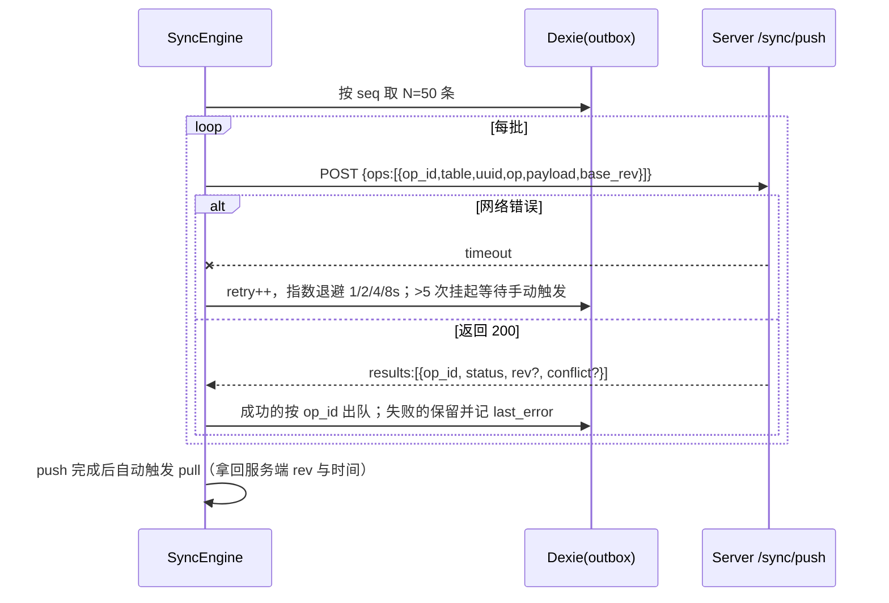
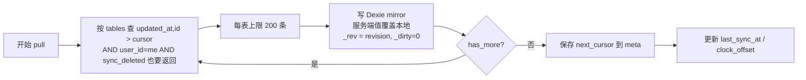
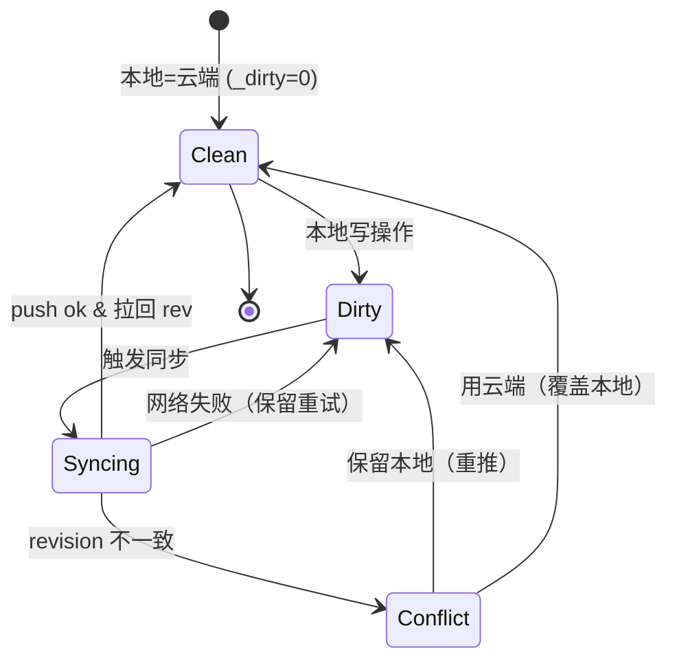

# 04 · 离线同步引擎详细设计

> **本项目技术核心。** 这一份没写清楚就动手，后面必然推倒重来。
> 设计目标：**本地数据永不丢失、多端最终一致、冲突可理解（用户能做决定）**。

---

## 1. 范围界定

| 走同步（离线可用） | 不走同步（纯在线） |
|---|---|
| `user_profile`（**仅白名单字段**：昵称/头像/签名/虚拟形象/番茄参数/隐私模式） | 评论（发帖后可见，**评论需联网**） |
| `tomato_record` | 房间成员、心跳、房间留言 |
| `mistake` | 资料列表本身、**资料点赞**（在线计数动作） |
| `resource_favorite` | 励志文案、梦校墙、虚拟形象库（静态资源） |
| **`post`（离线发帖，本次新增）** | AI 对话历史、**用户 AI Key（敏感凭证）** |
| `apply_record`（只读拉取 + 创建走在线） | — |

#### UGC（帖子）同步特殊规则 —— 新增，必须遵守
| 规则 | 说明 |
|---|---|
| **只同步自己的帖子** | 别人的帖子走在线拉取，不进本地 mirror 的写队列 |
| **本地草稿必须显式标注** | 同步前 UI 显示「待上传 · 仅本机可见」，避免用户误以为已发布 |
| **禁止离线修改他人内容** | 不可能发生（无权限），DAO 层强制 `user_id` 过滤 |
| **冲突面极窄** | 只有同一用户多端改同一帖才冲突，走既有二选一；**不做字段级合并** |
| **删除走墓碑** | 同其他表，`sync_deleted=1` 随同步传播 |
| **图片先传后发** | 离线发的帖子若含图：图片先入上传队列，联网后先传图拿到 URL 再发帖子（**顺序保证**，否则帖子引用空图） |

> 补充裁决：**申请提交走在线**（离线提交意义不大且需审核），但申请记录本地留存以便展示；**离线不可用统一返回错误码 `OFFLINE_UNAVAILABLE`**，前端据此展示优雅降级 UI，而不是报错小白页。

---

## 2. 数据模型

### 2.1 客户端 Dexie Schema

```
version(1).stores({
  // 镜像表（=_mirror）：结构与服务端对应记录一致
  tomato:   '&uuid, user_id, start_at, _dirty, _rev',
  mistake:  '&uuid, user_id, next_review_at, _dirty, _rev',
  favorite: '&uuid, user_id, resource_id, _dirty, _rev',
  profile:  '&key, _rev',       // 用户档案白名单字段 + setting_* 展平键（见 §5.1）
  post:     '&uuid, user_id, created_at, _dirty, _rev',   // 离线发帖（F-35）
  apply:    '&uuid, user_id, status, _rev',               // 申请记录只读镜像（离线可看历史）

  // 发件箱：严格 FIFO
  outbox:   '++seq, [table+uuid], created_at, retry, last_error',

  // 元信息
  meta:     '&key'          // cursor、clock_offset、last_sync_at、device_id
})
```

每条 mirror 记录的本地私有字段（下划线前缀不上传）：

| 字段 | 含义 |
|---|---|
| `uuid` | 客户端生成的业务主键（主键同步锚点） |
| `_rev` | **上次从服务端同步到的 revision**（即 base revision） |
| `_dirty` | 是否有本地未推送修改 |
| `_local_updated_at` | 本地修改时间（用于 UI 展示） |

### 2.2 服务端同步三件套

每条记录携带：`revision`（每次写 +1）、`updated_at`（DATETIME(6)，作为拉流排序键）、`sync_deleted`（墓碑标记，删除随同步传播）。

---

## 3. Outbox 队列规则

### 3.1 入队

任何写操作（`create / update / delete`）都必须：

```js
await db.transaction('rw', db.tomato, db.outbox, async () => {
  await db.tomato.put({ ...record, _dirty: 1 })
  await db.outbox.add({
    table: 'tomato', uuid, op: 'update',
    payload: diffOrFull,      // create/update 传全量字段；delete 传 {}
    op_id: crypto.randomUUID(),   // 幂等键（重试用同一个）
    base_rev: record._rev,
    created_at: Date.now(), retry: 0
  })
})
```

### 3.2 铁律

| 规则 | 原因 |
|---|---|
| **严格 FIFO**，按 `seq` 顺序发送 | 「改→删」若并发发送变成「删→改」，数据会复活 |
| **同一 `uuid` 的操作不可并发** | 同一记录多条 mutation 必须串行，否则 revision 竞争 |
| `delete` **必须是墓碑**（写 `sync_deleted=1`），不是本地真删 | 否则服务端不知道你删了，下次 pull 又拉回来 |
| `op_id` 在重试时**保持不变** | 服务端据此去重，避免重试造成重复创建 |
| **字段白名单**：`profile` 只允许推 `nickname/avatar_url/signature/privacy_mode/番茄参数` | `vip_level`、`vip_expire_at`、`role`、`status` 属服务端权威字段，客户端推送一律丢弃并记 WARN（防伪造 VIP，见 `02-ARCH` ADR-010） |
| 同步成功才出队；失败保留 `retry` 计数 | 兜底：永不丢数据 |

### 3.3 同记录操作合并（可选优化，一期不做）
连续多次 update 同一条可合并成最后一次。一期先保留全部（逻辑更简单），观察性能再说。

---

## 4. 推送流程（Push）



### 4.1 服务端幂等

```python
for op in ops:
    # 1) 已处理过 → 直接返回上次结果（网络重试/重复提交）
    log = SyncOpLog.get(op_id=op.op_id)
    if log: results.append(log.result); continue

    # 2) revision 校验
    rec = dao.get_by_uuid(op.uuid)
    if op.op in ('update','delete') and rec.revision != op.base_rev:
        results.append({'op_id': op.op_id, 'status': 'conflict',
                        'server': serialize(rec)})     # ← 冲突，含服务端版本用于对比
        continue

    # 3) 应用 + revision+1 + updated_at 显式赋值
    apply(op); rec.revision += 1; rec.updated_at = now_utc()
    SyncOpLog.create(op_id=op.op_id, result=...)
    results.append({'op_id': op.op_id, 'status': 'ok', 'rev': rec.revision})
```

> `sync_op_log` 表按 `op_id` 唯一索引，保留 7 天后清理。

### 4.2 create 的幂等特别注意
断网重试时若第一次其实已成功但响应丢失，客户端会用**同一个 op_id** 重试 → 服务端查 `sync_op_log` 命中，返回原结果，不会创建第二条。**这是"不多不少"的关键**。

---

## 5. 拉取流程（Pull）

```
GET /sync/pull
  ?tables=tomato,mistake,favorite,post,apply,profile
  &cursor=<base64(updated_at|id)>     # 首次为空
→
{
  changes: { tomato: [...], mistake: [...], ... },
  next_cursor: "...",
  has_more: true/false,
  server_time: 1730000000.123         # ← 用于时钟校正
}
```



要点：
- **删除必须随同步返回**（`sync_deleted=1`），客户端收到后本地移除对应记录
- cursor 必须每批提交后再更新，防止中途失败导致漏拉（用「本地最后成功批」落盘）
- pull 回来的 UTC 时间用于渲染与统计；本地 UI 一律转本地时区
- **表清单只写在一处**：客户端与服务端共用常量 `SYNC_TABLES = ['tomato','mistake','favorite','post','apply','profile']`，服务端按白名单过滤，不接受客户端自定义表名

> ⚠️ 本节示例原为 4 张表（漏 `post` / `apply`）。后果不是"少一个功能"，而是 **push 上得去、pull 拉不回来**：换设备或清缓存（S-13）后，自己离线发的帖子在本地永久消失，而服务端明明有。属于"漏一个字符串"级别的 bug，所以改成单点常量，禁止各接口手写。

### 5.1 `profile` 的展平约定（用户档案 + 番茄参数）

`profile` 不是数据库里的一张表，而是**两个来源的 key-value 投影**：

| 上游 | 展平后的键 | 写回目标 |
|---|---|---|
| `user` 白名单字段 | `nickname` / `avatar_url` / `signature` / `figure_id` / `privacy_mode` | `user` 对应列 |
| `tomato_setting` | `setting_focus_min` / `setting_short_break_min` / `setting_long_break_min` / `setting_long_break_interval` / `setting_auto_next` | `tomato_setting` 对应列 |

- 为什么不直接同步 `tomato_setting` 表：Dexie 的 `profile` 已经是 key-value 表，新增实体表要升 `version()` 并写迁移；展平可零成本扩参数。
- `setting_*` 前缀是**保留前缀**，`profile` 里出现该前缀的键一律路由到 `tomato_setting`，其余按 `user` 白名单处理（见 §3.2 字段白名单）。
- 服务端 `pull` 时把两张表的变更合并成一个 `changes.profile` 数组，按 `updated_at` 排序；`revision` 取 `user.revision` 与 `tomato_setting.revision` 的较大值。

---

## 6. 时钟漂移处理（最容易埋雷）

**问题**：番茄时长依赖时间差。用户可能：改系统时间、设备时间不准、休眠导致定时器不准。

**方案**：

```
1. 任何一次成功的 HTTP 响应都携带 server_time
2. clock_offset = server_time - Date.now()      // 存 meta，每次同源更新
3. 所有"当前时间"取 serverNow() = Date.now() + clock_offset
4. 番茄 start_at 由服务端签发（离线时用 serverNow()）
5. 定时器只用 performance.now() / Date.now() 的**差值**，不用挂钟做判断依据
```

| 场景 | 处理 |
|---|---|
| 用户中途把系统时间往前调 2 小时 | 用的是 serverNow 差值用于展示；但 Count Up 仍按真实 elapsed（见下） |
| 离线开启番茄，联网后校正 | `start_at` 用当时 serverNow；联网后 `GET /server/time` 校准，若偏差 > 5min，修正 `start_at` 并写 `clock_offset_ms` 留痕 |
| 系统休眠/息屏导致 tick 被节流 | 用 `Date.now()` 差值补算，不用 "tick 计数 × 1s" 累加 |

> **番茄结束时的 `actual` 一律用 `end(serverNow) - start_at - pause_total` 计算，绝不用 tick 累加计数。**

---

## 7. 冲突处理

### 7.1 判定
`push` 时 `base_rev != server.revision` → 冲突。返回服务端版本。

### 7.2 UI

```
┌──────────────────────────────────────┐
│  数据冲突：番茄记录 10-24 14:00       │
├──────────────────────────────────────┤
│  本地版本（本机刚才修改）              │
│  时长 25min   备注 数学复习            │
├──────────────────────────────────────┤
│  云端版本（其他设备）                  │
│  时长 40min   备注 高数作业            │
├──────────────────────────────────────┤
│  [ 保留本地 ]        [ 用云端覆盖 ]    │
└──────────────────────────────────────┘
```

### 7.3 两条处理路径

| 选择 | 行为 |
|---|---|
| **保留本地** | 用刚才返回的 `server.revision` 作为新 base_rev，重新 push（force，携带正确 rev）→ 服务端接受，revision+1 |
| **用云端** | 把服务端版本写入本地 mirror（`_rev=server.revision`, `_dirty=0`），并从 outbox 删除该 uuid 的所有待发操作 |

### 7.4 状态机



### 7.5 一期明确不做
- 字段级智能合并
- 自动解决策略（如"取更新的那个"，即 LWW）
- 多设备实时协作

---

## 8. 错误处理与重试

| 错误 | 处理 |
|---|---|
| 网络不可用（离线事件） | 挂起；监听 `online` 事件恢复 |
| 5xx / 超时 | 指数退避 1/2/4/8s，最多 5 次/轮；之后等待下次触发时机 |
| `401 TOKEN_EXPIRED` | **暂停同步** → 静默 refresh → 成功后自动继续；refresh 失败则停止并提示重新登录 |
| `409 CONFLICT` | 进入冲突 UI（此时**暂停队列**，避免后续连锁冲突） |
| `400 VALIDATION_ERROR` | 语义错误，重试无用 → 出队并记入本地失败清单（UI 提示），避免堵住队列 |
| `429 RATE_LIMIT` | 退避 30s 重试 |

> 队列阻塞保护：若队首连续失败 N 次，整个队列暂停，UI 显示"同步暂停（1）"并可查看/重试，防止无限循环打服务端。

---

## 9. 边界用例矩阵（必须全部通过才能算同步层完成）

| # | 场景 | 期望 |
|---|---|---|
| S-01 | 断网创建 3 条番茄再联网 | 服务端恰好 3 条，本地队列清空 |
| S-02 | 同步中（第 2 批）断网 | 第 1 批已出队不重复，第 2 批保留 |
| S-03 | 同一条连续 update 3 次 | 最终值与服务端一致；中间态不残留 |
| S-04 | 设备 A 离线改、设备 B 在线改同一条 | A 联网后弹冲突；任选一端后两端一致，再同步无冲突 |
| S-05 | 离线删除后联网 | 服务端墓碑生效；再换新设备拉pull，看不到该条 |
| S-06 | 服务端曾经已收、客户端以为失败重发 | 靠 `op_id` 命中，不产生第二条 |
| S-07 | 弱网请求超时但服务端已处理 | 同上，幂等保证不重复 |
| S-08 | 手动点同步（连续点 3 次） | 全局串行锁，不并发；第二次直接返回"同步进行中" |
| S-09 | token 过期期间触发同步 | 静默刷新后自动继续，用户无感 |
| S-10 | 本地数据与服务端同一 revision | 不产生任何写请求（空 diff） |
| S-11 | 跨零点（23:55 开始，00:10 结束） | 归属日期按本地时区划分，天数不串 |
| S-12 | 客户端系统时间被改到未来 | 用 serverNow 校正，番茄时长不被刷高 |
| S-13 | 清缓存后重新登录 | pull 全量，本地重建；番茄记录不丢（服务端有） |
| S-14 | 队列队首语义错误（400） | 隔离该条，不阻塞后续队列 |

---

## 10. 与 UI 的契约

| 组件 | 职责 |
|---|---|
| 顶部同步状态指示器 | 显示 已同步/同步中(N)/离线/冲突(1)/暂停；点击可手动同步 |
| 冲突弹窗 | 全局单例（同时只弹一个，排队处理） |
| 离线横幅 | 首次离线时提示"离线可用：番茄、错题、收藏" |

**同步指示器状态**：`synced` / `syncing` / `offline` / `conflict` / `paused` / `error`
