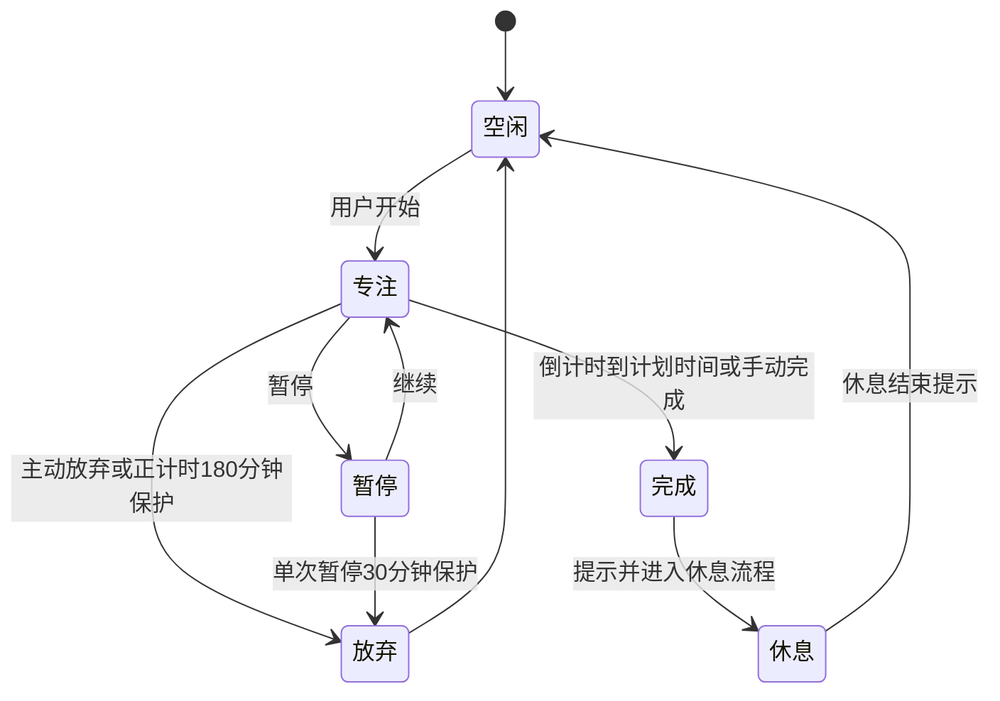
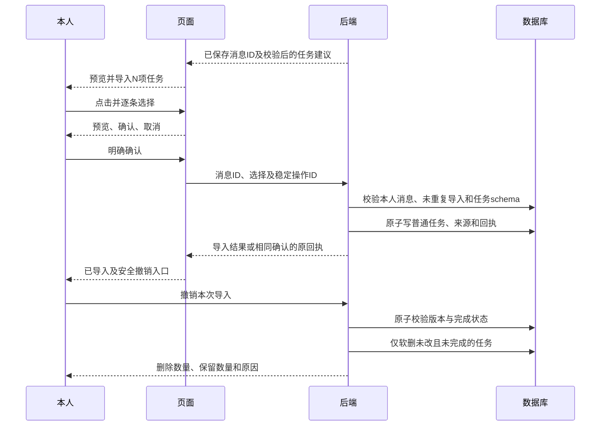

# 核心业务流程

> 2026-10-29规则更新：[好友房间共享](../room-sharing-2026-10-29.md)取代本文旧全站小组、独立入组及四人限制描述。房间成员确认后即为共享小组；账号/VIP不入房。其余未冲突条款继续有效。

以下为当前目标合同，是否实现见[开发状态](../implementation-status.md)，规则见[统一规则](PRD-当前规则.md)。

## 1. 登录和权限

验证码/密码验证 → 账号状态与注册策略 → 会话 → 独立本地库 → 同步。网站注册、受邀小组加入、房间加入分别校验。VIP或有效功能授权不替代对象归属、隐私或服务配置。

## 2. 学习计时

休息结束不自动开新一轮专注；倒计时恢复按计划结束边界结算，不赠送额外无人确认时间。学习写入与入队原子，后端同口径校验。

## 3. 在线、状态与房间

前台设备续约网站心跳 → 验证进入某房间的资格 → 更新当前房间 → 列表按有效心跳聚合。离开页面清当前位置但可仍网站在线，退出房间成员另作操作。对隐私用户统一只返回隐私中；其他人不能从room或isOnline推断位置与活动。

当前给所有已加入房间续约的代码尚不满足这一目标，需要修复，不能按该实现反向定义当前位置。

## 4. 审批与通知

功能申请pending → 管理员校验仍待审 → 同事务写批准/驳回、授权、站内消息与审计 → 提交 → 邮件异步。重复处理拒绝或返回明确结果，不重复通知；用户可撤回待审申请，撤销授权及时生效。

## 5. 内容审核

资料/励志投稿 → 待审仅本人及获准审核者可见 → 通过后公开，驳回含原因并通知。资料公开仍按查看资格脱敏链接，个人备注只给本人。已批准资料修改保留批准快照，新版重新审核。动态评论直接发布，管理员可因违规删除并通知。

## 6. 同步与附件

本地事务写记录/队列 → 图片补传为key → commands推送 → 幂等和版本校验 → 本人增量拉取 → 安全落库后推进游标。冲突挂起并展示二选一，不因失败或换号清除用户数据。

图片读取：登录 → 业务引用/归属/受邀关系/隐私/公开审核校验 → 鉴权代理或受控短期凭据。知道key不等于有权，签名也不替代校验。

## 7. AI模型和会话

配置服务商/地址/Key → 清空旧模型 → 后端按配置隔离缓存请求/models → 合法目录选择或失败手填 → 加密保存。配置变化丢弃迟到响应；强制刷新绕过TTL，同配置并发合并。六类错误分别提示，原始敏感上游正文不回前端。

本人会话 → 后端查询本人已同步学习摘要并有界截断 → 私有历史及本次问题 → 供应商SSE → 保存消息及实际用量。只读本人，隐私开关不阻断；不传组员、密码、Key或个人备注。

## 8. AI任务预览、确认和撤销

普通回复写“等待确认”不能制造任务或自动弹可执行确认；解析失败保持页面稳定，隐藏导入按钮并允许重新生成。已实现预览选择、来源/导入状态、稳定回执和安全撤销；自动测试与实机验收结果分开记录。

## 9. 管理与恢复

管理员封禁保留数据，VIP等操作有原因和前后值审计；无私密学习明细/AI旁路。诊断和邮件失败可查询，备份一致性/哈希/外键验证，恢复到新目录再验证；实际邮件、七牛、AI和HTTPS联调单独记录。
