# 05 · 核心流程时序图

> 所有跨端流程都在这里。写代码前先对着图确认一遍，能省掉一半返工。

---

## 1. 邮箱验证码登录 + JWT 无感续期

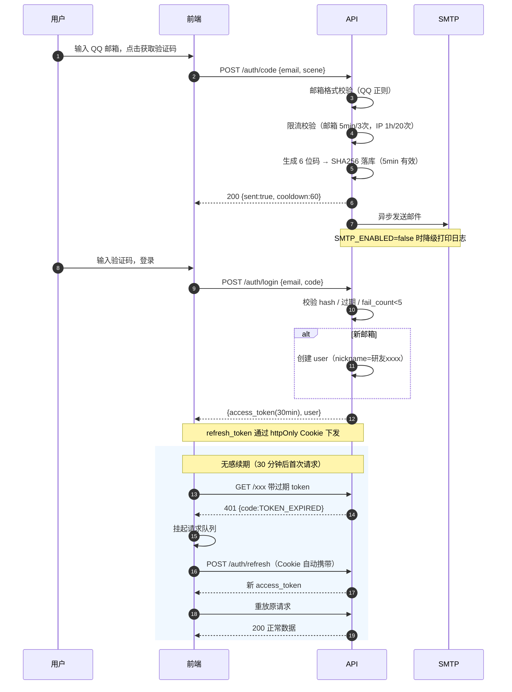

**要点**
- 刷新期间并发请求必须**排队**，不能直接丢弃或并发触发多个 refresh
- refresh 失败（超过 7 天）→ 清本地态 → 跳登录页
- 单设备的多次登录不互踢（一期允许多端）

---

## 2. 番茄生命周期（含暂停 / 超时 / 休息）

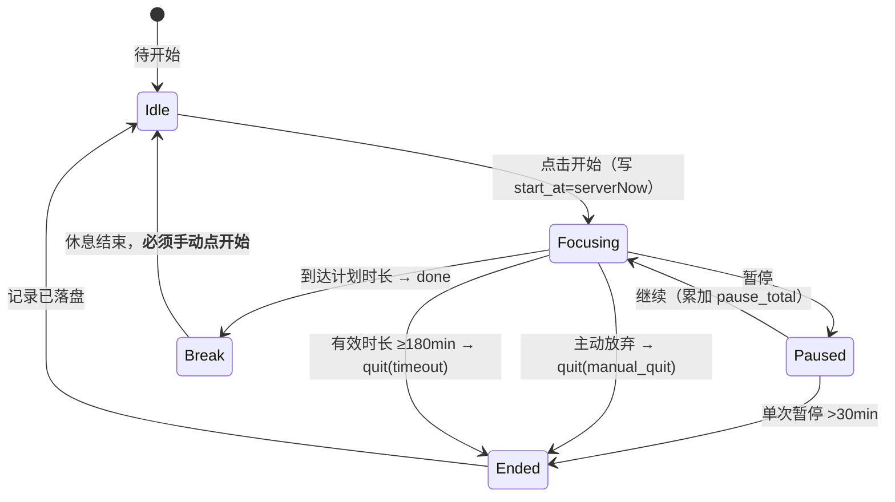

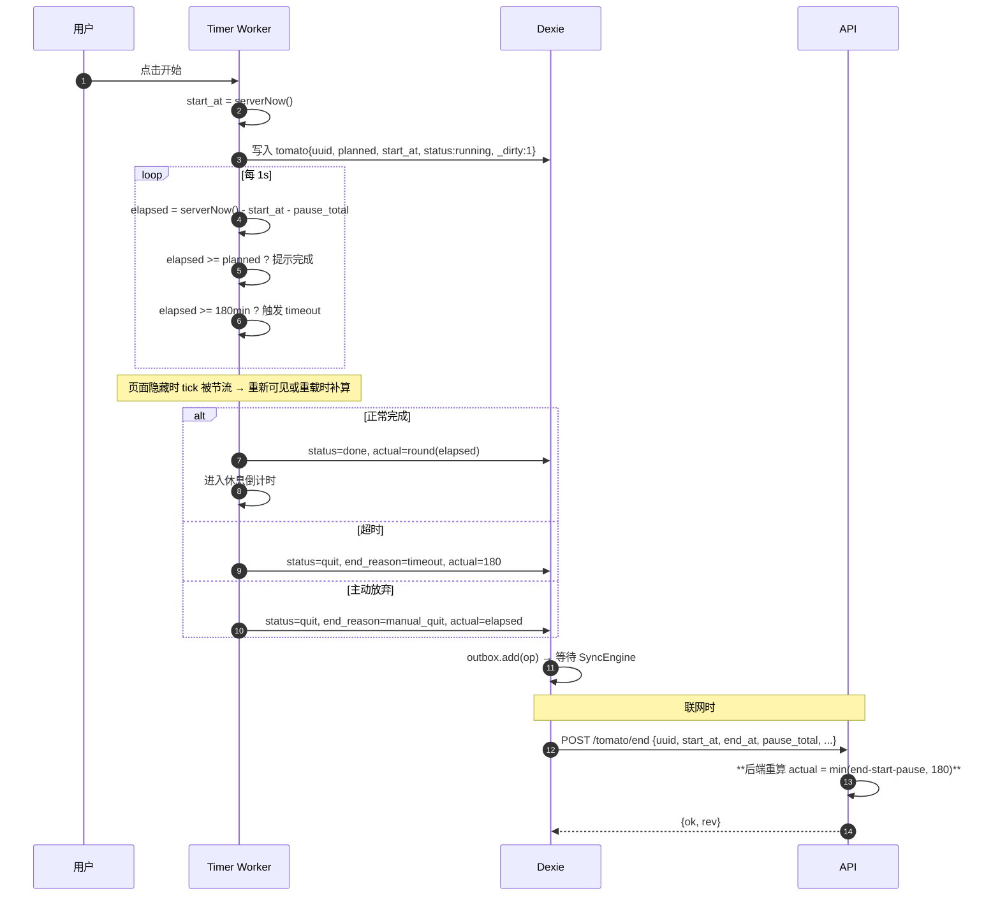

**三处必须一致**：前端 tick 判定 / 页面唤醒补算 / 后端兜底重算，用同一个常量 `MAX_TOMATO_MINUTES=180`。

**统计口径**
| 指标 | 口径 |
|---|---|
| 今日专注时长 | `sum(actual_minutes)`，含超时封顶的 180 |
| 今日完成番茄数 | `count(status=done)`，**不含** quit |
| 归属日期 | 按 `start_at` 转为**用户本地时区**后的日期 |

---

## 3. 功能申请 → 审批 → 双通道通知

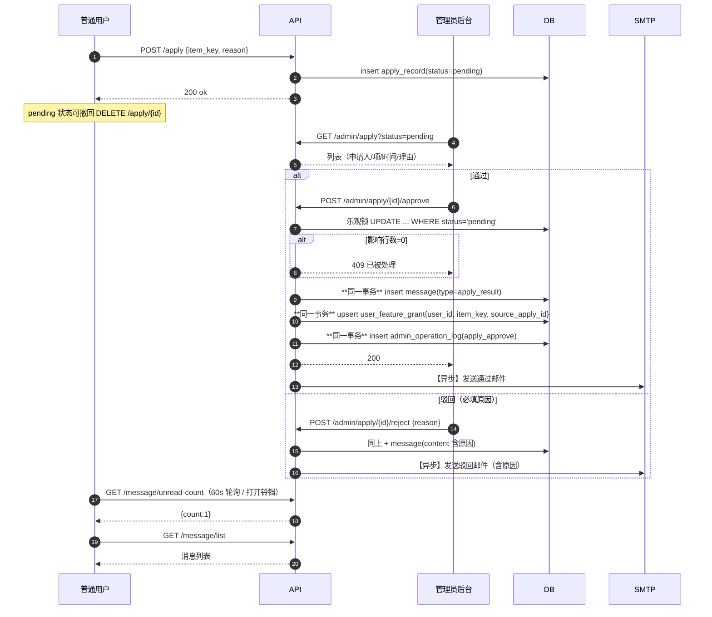

**幂等保障**：`message` 表 `(user_id, biz_type='apply', biz_id)` 唯一索引 → 重复点击审批不会重复通知。
**邮件失败**：写 `email_log(status=fail)`，后台可手动重发，不影响站内消息与主流程。

**⚠️ 权限落地（原稿写的是「`user.item_grant` 生效（或 vip 权限位）」，但 `user` 表没有这个字段，也没有授权表 —— 等于审批只能通知、不能授权）**
- 授权写独立表 `user_feature_grant`（`03-DB` §3.1），`apply_record` 只管流程状态，**不代表用户拥有该权限**
- 鉴权统一走 `is_vip() or grant_exists(item_key)`，**禁止**读 `apply_record.status='approved'` 判权限（否则撤销/到期无法生效）
- 撤销（`revoked_at`）与到期（`expire_at`）都只改授权表，不回写申请记录；`revoked` 申请状态只表示流程被终结

---

## 4. 同步流程（正常 + 冲突）

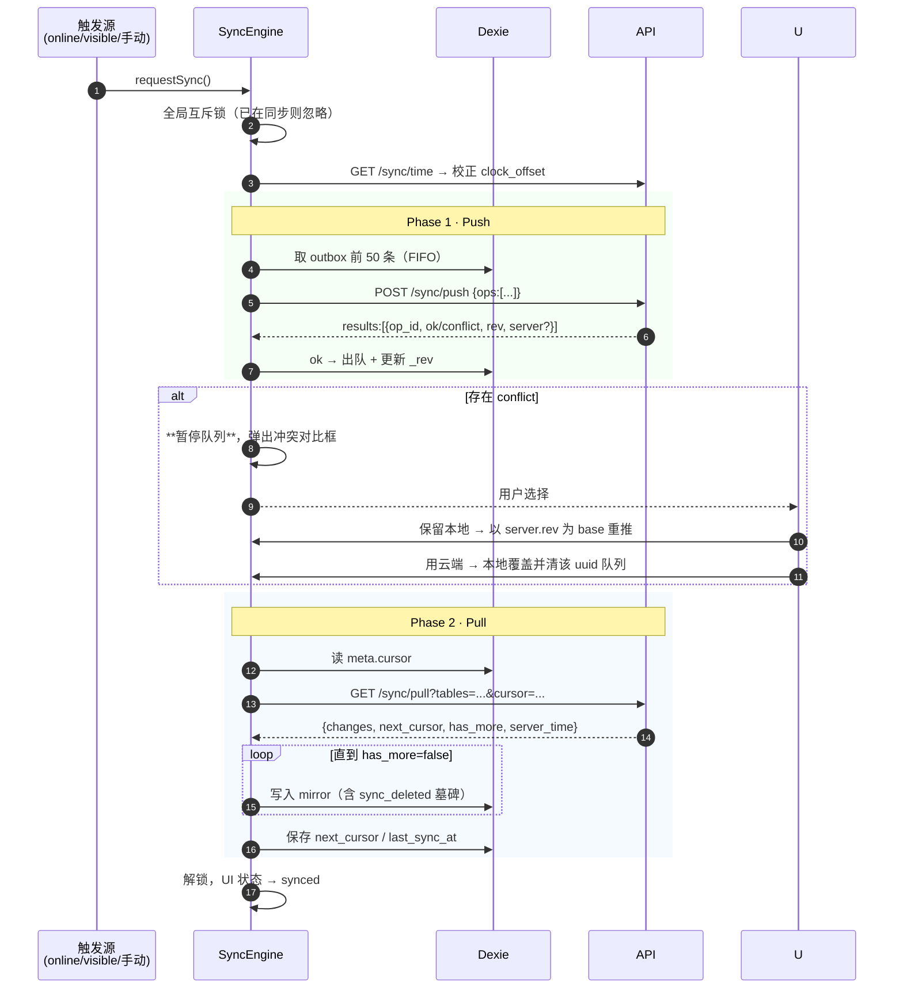

---

## 5. 自习室进入 / 心跳 / 离线判定

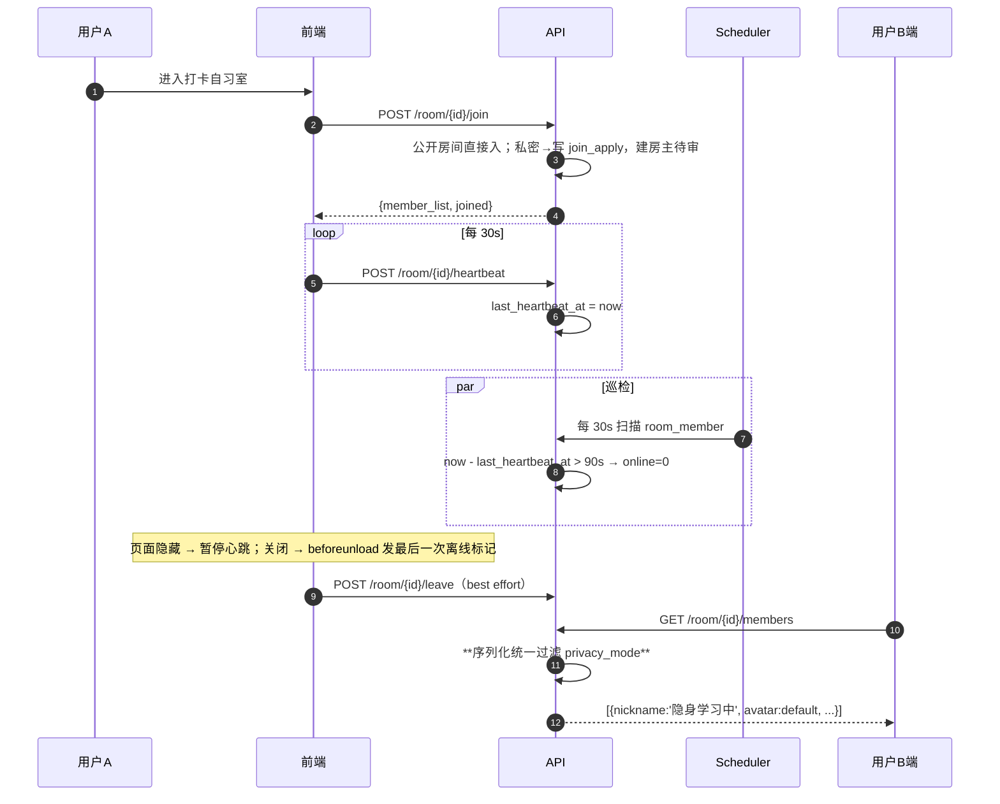

**番茄独立性**：心跳离线不改变任何番茄记录的状态。番茄结束由自身完成条件触发，即使此刻判定为"离线"也照常记录。

**在线人数口径**：`count(online=1)`，隐私用户计入人数但匿名展示。

---

## 6. 图片上传（头像 / 错题配图）

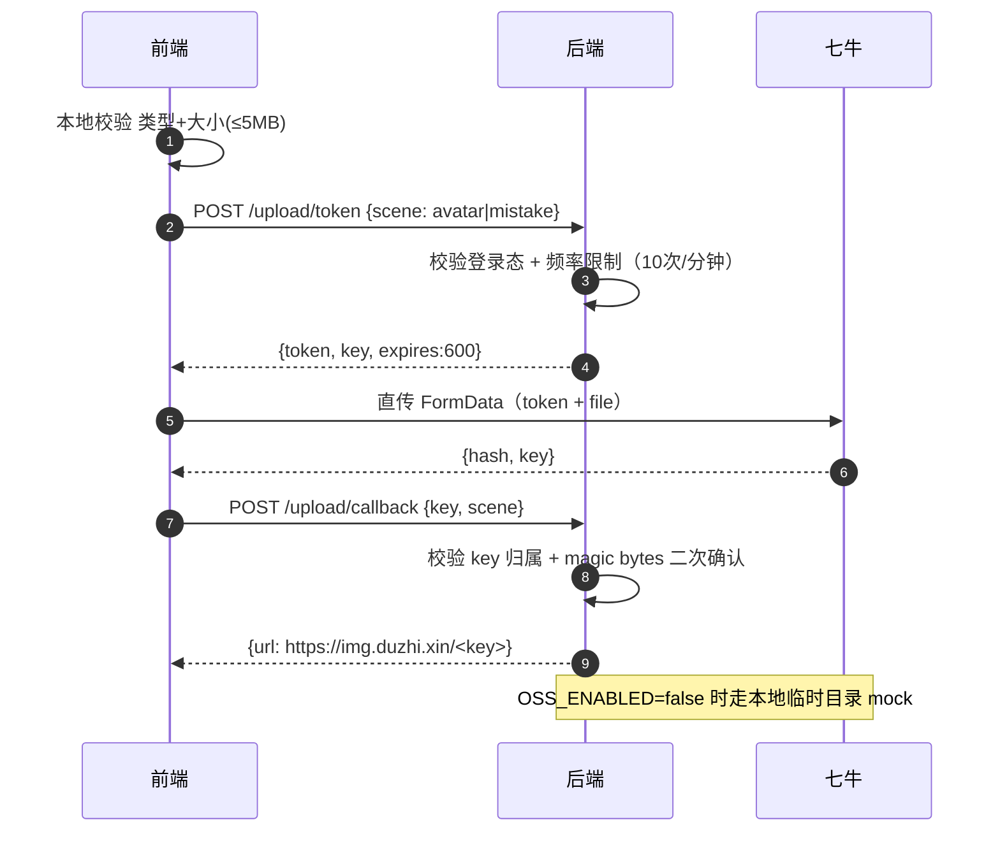

---

## 7. AI Key 配置与调用（方案 B · 用户自填）

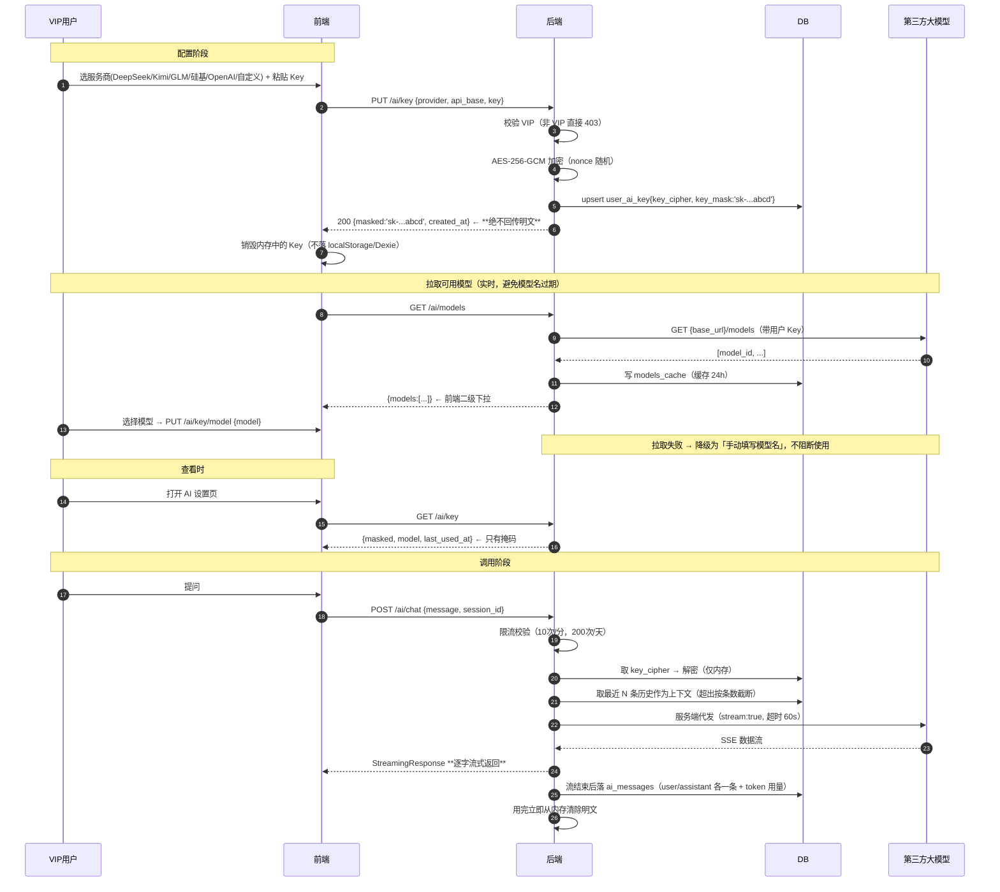

### 7.1 拉取模型：错误分类与降级

`GET/POST /ai/models` 由后端代理，前端**永远不直接请求服务商**。上游结果必须翻译成五类，前端据此决定"禁下拉 / 开手填 / 保留上次"：

| 上游 | 服务端判定 | 返回前端 | 前端动作 |
|---|---|---|---|
| 401 / 403 | Key 无效或无权限 | `AI_KEY_INVALID` | 禁用下拉 + 开手填 |
| 402 / body 含 `insufficient` `balance` `quota` | 欠费 | `AI_NO_QUOTA` | 同上 |
| 404 / 405 | 无 `/models` 端点 | `AI_NO_MODELS_API` | 直接开手填 |
| 超时 8s | `asyncio.TimeoutError` | `AI_UPSTREAM_TIMEOUT` | 同上 |
| 5xx | 上游故障 | `AI_UPSTREAM_ERROR` | **保留上次结果** |
| 429 | 限流 | `AI_RATE_LIMITED`（带 retry_after） | 保留上次结果 |

- 上游 body **只进服务端日志且已脱敏**，不回传前端；错误对象里不得出现 Key 片段。
- 拉取成功但列表为空 → 按 `AI_NO_MODELS_API` 处理（有些兼容网关会返回 `{"data":[]}`）。

### 7.2 缓存与失效：防止跨服务商串味

- 缓存键：`(user_id, provider, base_url, key_fingerprint)`，`key_fingerprint = sha256(key)[:16]`，只存指纹不存明文。
- 命中条件：24h 内 **且** `provider` / `base_url` / `key_fingerprint` 三者都未变。
- **切换服务商或换 Key 立即作废**（不靠 TTL），否则 A 家的 `deepseek-v4-pro` 会被带到 B 家的下拉里。
- 用户主动点「重新拉取」→ 无视 TTL 重打一次。
- 并发点击 → **single-flight**：同一用户同一缓存的并发请求只打上游一次，其余复用结果。

### 7.3 上下文注入：让 AI 知道你昨天学了什么

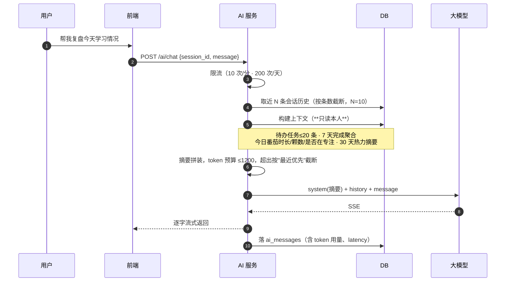

**三条边界**（写死，别在实现时松口）：
1. **只读本人**：`WHERE user_id = current_user.id`，不读同圈成员，也不读被移出圈子的历史数据；
2. **只给摘要**：任务最多 20 条、统计只给聚合值，绝不把原始行整表塞进 prompt；
3. **`privacy_mode` 不阻断**：隐私模式是"不让别人看"，AI 是"给自己用"；但摘要里**不得出现他人昵称**。

### 7.4 任务导入：唯一会写数据的 AI 能力

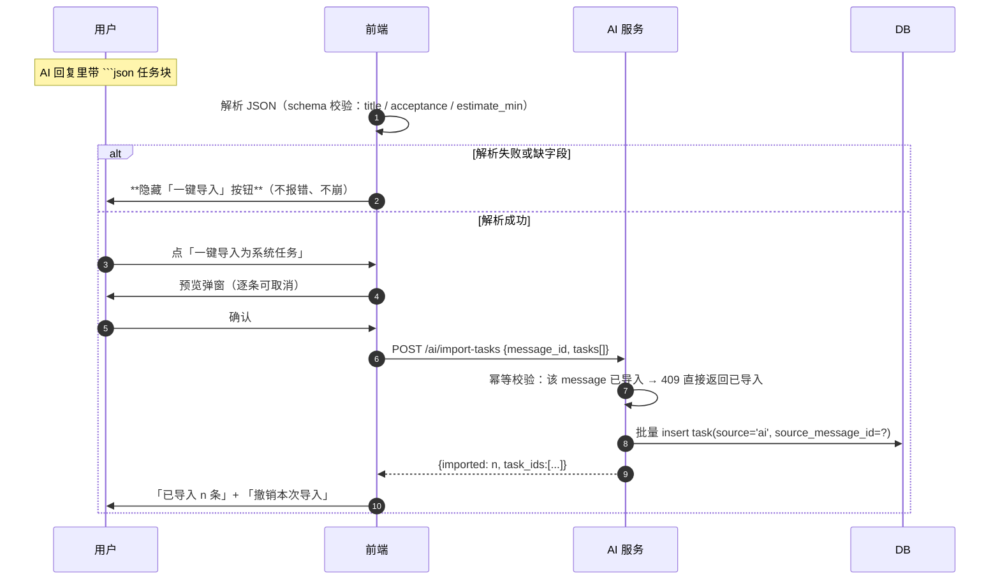

- **禁止静默新增**：没有确认弹窗就不许写库；这是硬性验收项。
- 幂等：`source_message_id` + `imported_at` 判重，同一条回复只能导一次（重复请求返回 409 与已导入数量）。
- 撤销：按 `source_message_id` 批量软删（`deleted_at`），并写入 `admin_operation_log` 之外的**用户操作记录**（`task` 表本身的 `deleted_at` 足够追溯）。
- 导入的任务与手动任务同构：同表、同同步、同圈子聚合、同隐私规则。

### 7.5 红线汇总

- `key_cipher` 任何接口都不返回；第三方错误统一脱敏；**AI Key 与对话记录都不进离线同步**。
- 所有服务商走 OpenAI 兼容的 `/v1/chat/completions`，一个适配器通吃；非该协议一期不接。
- 模型 id **不写死在前端**：下拉内容一律来自本次拉取结果或用户手填。

---

## 8. 管理员调整 VIP

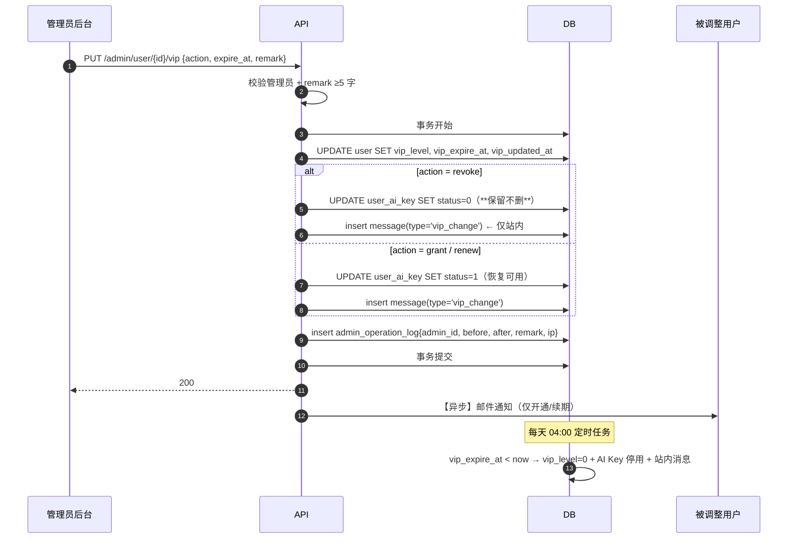

**说明**
- 降级后用户**立即**失去完整链接与 AI 使用权；Key 不删除，恢复 VIP 后自动可用
- 管理员不能删除 `admin_operation_log`，保证可追溯
- VIP 状态属服务端权威，同步时客户端无法篡改（见 `04-SYNC` 字段白名单）

---

## 9. 圈子加入 / 审核 / 退出（二期草案）

> 对应 `01-PRD` §8 与 `03-DB` §3.8。一期不实现，此节为二期设计基线。

### 9.1 加入时序（四档合一）

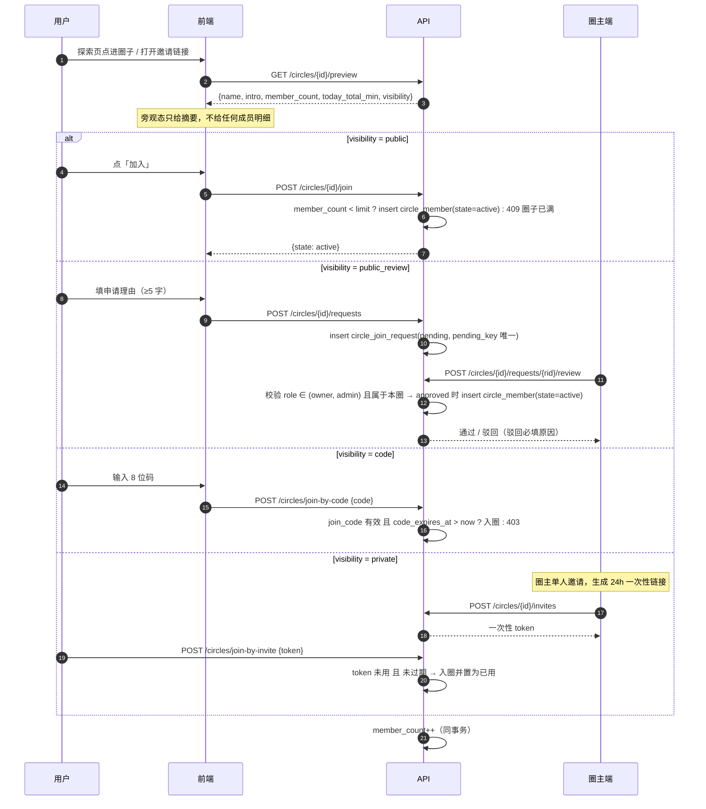

**四种入口共用一条落地逻辑**：`circle_member` 落一行 `state=active`，再同事务 `member_count++`。区别只在「前置校验」，不要写成四套代码。

**码的防爆破**：`code` 档 8 位大写码理论上可枚举，必须加限流——同一 IP / 同一 user 每小时最多 10 次失败，超限 403 并记 `admin_operation_log`；码本身 7 天过期、圈主可随时重置。不要只靠"码够长"。

**圈主权限边界**：审核接口校验 `role ∈ (owner, admin)` 且属于**本圈**；绝不能复用平台管理员的 `/admin/*` 前缀，否则圈主会拿到跨圈能力。

### 9.2 成员状态机

```
（无记录）
   │ 申请/邀请/自助
   ▼
pending ──圈主通过──► active ──退出──► left ──30天内重进──► 需圈主同意
   │                    │
   │ 驳回/撤回           │ 被移出
   ▼                    ▼
rejected            blocked（拉黑，探索页不可见）
```

- `left` 不删行，`left_at` 是「30 天重进需审批」的唯一依据；
- `blocked` 由圈主操作，解除也要圈主操作，没有自动过期；
- 一个人在同一圈子只有一行，状态流转就地更新，**不要 insert 新行**（唯一索引也会挡）。

### 9.3 退出 / 撤权的收敛顺序

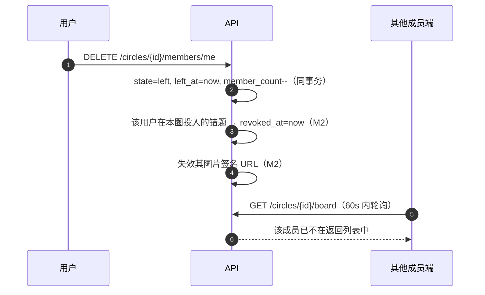

**验收口径**：看板是**服务端聚合**，不依赖客户端删缓存——退出后最多一个轮询周期（60s）内消失，不出现"人退了数字还在"。

### 9.4 房间与圈子的校验关系

- 一期：进房校验 `room.invite_code` / 房间申请（F-20/F-21）。
- 二期：**进圈校验一次，进圈内房间不再校验**。`POST /circles/{cid}/rooms/{rid}/join` 只看两点：① 是否 `circle_member.state=active`；② 房间是否 `open`。房间不再有自己的码。
- 这样避免"进了圈还要再找房间码"的双重门槛，也让 F-21 的语义从"房间码"干净地迁到"圈子码"。

### 9.5 与隐私模式的叠加

| 场景 | `privacy_mode=0` | `privacy_mode=1` |
|---|---|---|
| 圈内看板 | 按 `share_level` 展示 | 只显示「在线」，不显示任何数字 |
| 成员列表 | 昵称 + 形象 + 状态 + 今日时长 | 昵称 + 默认形象 + 状态，无时长 |
| 错题池 | 按投入情况展示 | 一律不展示（即使 `share_level=3`） |

**隐私模式优先级高于共享档位**，且是用户级一次设置、全圈子同时生效——不要给每个圈子各配一个"隐身开关"，那会让用户永远不确定自己现在到底隐没隐身。
